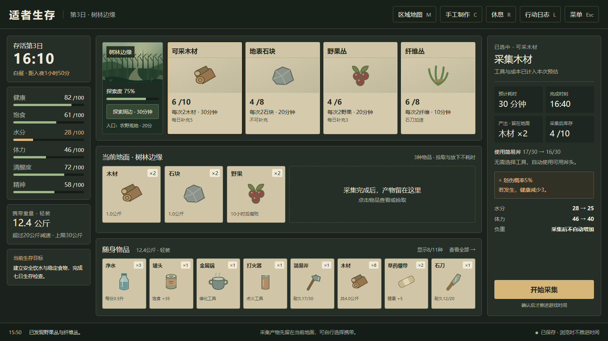
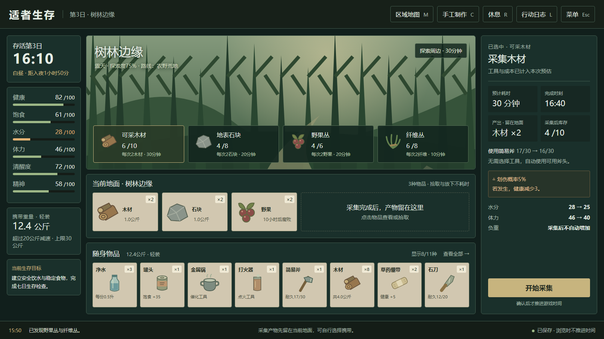
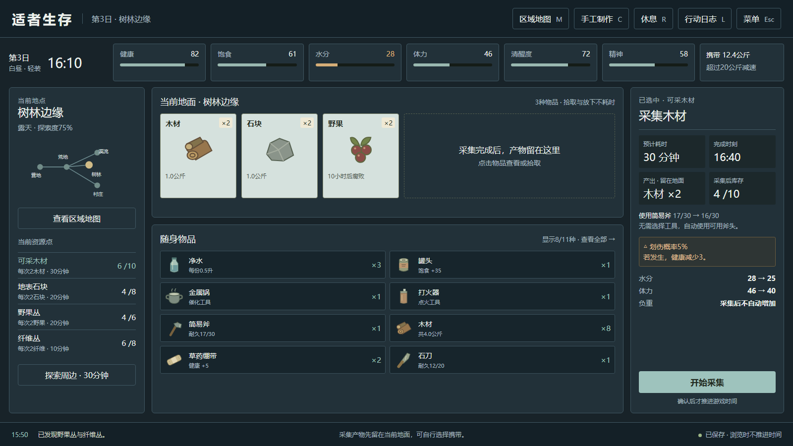
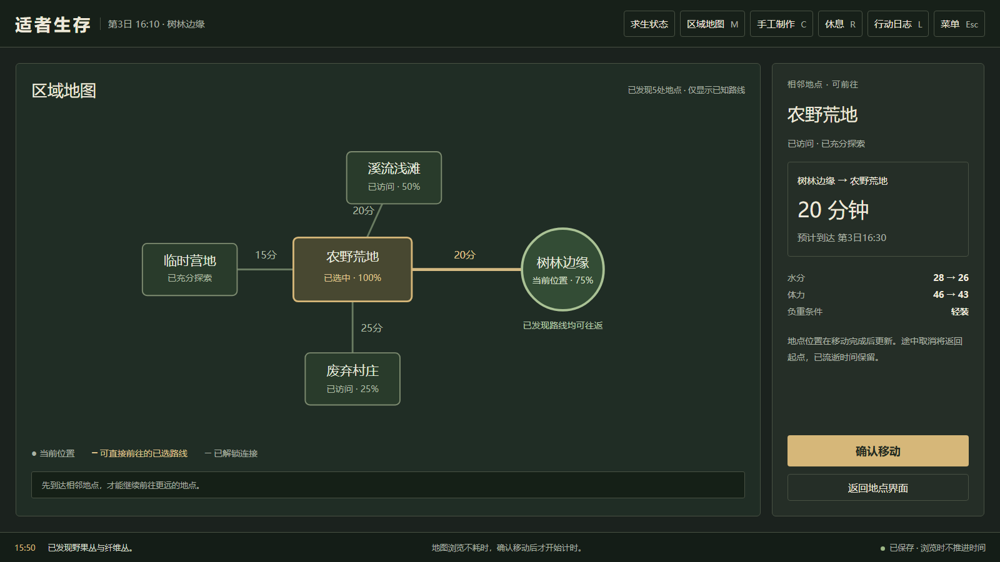
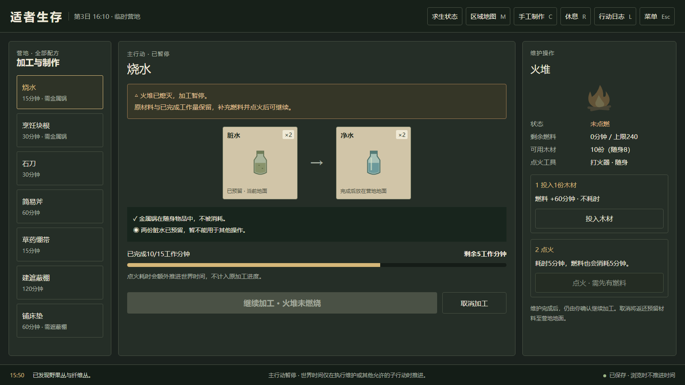
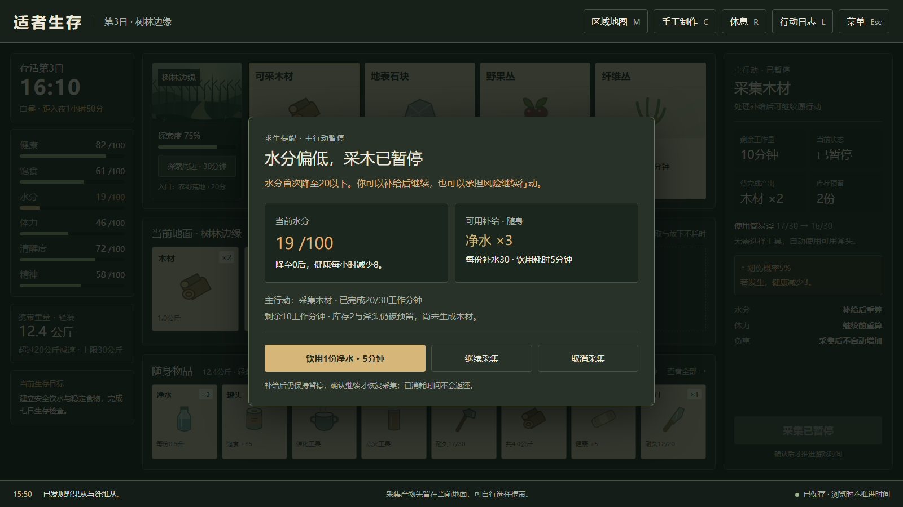

# 适者生存基础系统 UI 策划案

版本：UI v0.1 · 2026年10月22日  
对应玩法版本：基础系统 v0.2  
目标平台：PC，键盘与鼠标；基准设计画布1600×900，适配1920×1080与1280×720。

本案将地图、物资搜集、基础求生三套规则落实为界面、操作流程、状态反馈和验收条件，供三人团队进行布局评审和开发拆分。交付包括三套主界面候选图、三张关键交互图，以及可切换查看的本地预览。界面图使用项目自己的卡牌与图形示意；插画细节不作为最终美术品质要求。

本版继续搁置侵蚀、轮回、超能力、善恶值、招募、联机和战斗；不显示这些系统的占位入口。UI不修改既有玩法公式，不新增抽卡、卡组、槽位容量、自动搜集、自动寻路或离线收益。

## 01 设计目标与阅读依据

玩家应当在一个主界面内判断：我在哪里、还能去哪里、缺什么、眼前有什么、做一次行动能得到什么、会花多少时间，以及身体是否承受得住。

基础信息保持可见；详细条件和操作集中在选中对象的详情区。浏览、查看地图、切换物品和整理物品不推进时间；只有明确确认行动才开始结算。UI区分“探索发现”“采集产出”“本地拾取”，避免玩家误以为探索会直接将物品装入背包。

对应文档：

- [地图系统策划案 v0.2](<../基础系统 v0.2/Markdown/01 适者生存地图系统策划案 v0.2.md>)
- [物资搜集系统策划案 v0.2](<../基础系统 v0.2/Markdown/02 适者生存物资搜集系统策划案 v0.2.md>)
- [基础求生系统策划案 v0.2](<../基础系统 v0.2/Markdown/03 适者生存基础求生系统策划案 v0.2.md>)

三套主界面采用同一示例快照：第3日16:10，树林边缘，探索度75%，轻装12.4公斤；健康82、饱食61、水分28、体力46、清醒度72、精神58。选择“可采木材”，库存6/10，携带简易斧17/30；预计采集30分钟，产出2木材至地面，斧头耐久变为16/30。水分预计显示28→25，体力46→40；有5%概率划伤并损失3健康。

该快照用于公平比较信息布局。地图、加工和低水暂停细节图是各自独立的场景示例，不视为同一条连续操作记录。图中的数值取整表达与基础求生案一致；实际预估由玩法层提供，不能由UI用显示整数反算。

## 02 三套主界面方案

### A 卡牌桌面

左侧常驻求生状态；上方并列地点、路线与资源点；中部为当前地面；底部为随身物品；右侧集中呈现选中行动的产出、工具、风险和确认按钮。采用深绿桌面与浅色实体卡牌，强调“卡牌代表对象”的操作认知。

这是本次优先建议的实现起点：与既有地图案的界面描述直接对应，四类卡牌可以复用基础组件。主要风险是大量物品出现后横向卡牌较密，需要分类、滚动和同类归组。选择A不会要求先制作大型场景插画。

### B 场景聚焦

中央以地点场景建立空间感，资源点作为场景下方的固定操作卡；身体状态仍在左侧，动作详情仍在右侧，地面与背包保留独立区域。场景可以采用静态插画，点击对象不要求实现人物移动。

适合优先强调末日氛围与地点辨识。代价是每个地点需要更明确的场景表现规范，场景与功能区域争夺屏幕空间。首版若选择B，应先复用少量环境底图，不扩展成场景自由点击或寻物玩法。

### C 高效分栏

顶部横排六项状态与时间；左栏显示地点、已知路线和资源列表；中间管理地面与随身物品；右栏保留行动详情。物品更多采用图标列表，卡牌插画占比减少。

适合频繁比较库存、重量、保质期和配方条件。界面可读性依赖清晰分栏与足够字号，整体更接近生存工作台。相较A，卡牌视觉存在感较弱；相较B，环境美术需求较少。

### 如何选择

以下为本项目的相对设计判断，不是实际开发工时估算。

| 比较维度 | A 卡牌桌面 | B 场景聚焦 | C 高效分栏 |
| --- | --- | --- | --- |
| 第一眼关注 | 对象与卡牌操作 | 地点氛围 | 状态与物资管理 |
| 地图案原布局的匹配 | 直接对应 | 场景区域需调整 | 状态与资源位置需调整 |
| 单屏物品展示密度 | 中 | 中低 | 高 |
| 地点插画依赖 | 较低 | 较高 | 较低 |
| 三人团队的实现关注点 | 卡牌组件与滚动 | 场景底图与交互层 | 表格列表与信息层级 |
| 建议保留的优点 | 对象与动作关系直观 | 地点辨识鲜明 | 物资对比方便 |

最终可选择整套布局，也可以组合，例如“A的卡牌结构加C的顶部状态条”。以下详细规则用A作为说明基底；这不代表A已被选定。若选择B或C，沿用组件语义、按钮规则和状态机，仅调整布局与视觉皮肤。

## 03 页面结构与界面清单

| 编号 | 界面或组件 | 入口 | 必须完成的事情 |
| --- | --- | --- | --- |
| UI-01 | 开始与继续 | 启动游戏 | 新游戏、继续、设置；覆盖存档前确认 |
| UI-02 | 地点主界面 | 开局或完成移动 | 展示当前位置、状态、资源、地面与随身物品 |
| UI-03 | 地图总览 | M或顶部地图按钮 | 浏览已知地点；确认一次相邻移动 |
| UI-04 | 行动详情 | 点击地点、入口或资源点 | 预览条件、时间、产出、风险并确认 |
| UI-05 | 物品详情与数量框 | 点击地面或随身物品 | 查看批次、使用、拾取、放下与数量选择 |
| UI-06 | 加工与营地设施 | C、配方或设施卡 | 查看7条配方，预留材料并开始加工或建造 |
| UI-07 | 休息与睡眠 | R或休息按钮 | 选择时长，比较恢复与消耗后确认 |
| UI-08 | 行动进度与暂停 | 确认行动后 | 展示主行动、进度；取消或处理允许的子行动 |
| UI-09 | 求生危险提示 | 状态跨越阈值 | 暂停主行动，说明原因与可选处理 |
| UI-10 | 行动日志与状态说明 | L或状态条 | 查原因、成本、结果及状态效果 |
| UI-11 | 死亡与七日检查 | 游戏事件触发 | 死亡后结束；七日检查后允许继续 |

推荐导航关系：开始界面 → 地点主界面；地图、物品、加工、休息和日志均从主界面打开，关闭后返回原选中对象与滚动位置。主行动进行中，地图只允许浏览；不能从其他界面绕过主行动占用再开始第二个移动、搜集或制造。

## 04 主界面信息层级

### 固定信息

地点主界面中，时间、天数、六项状态、负重与当前位置常驻。地图与加工等全屏工具页保留天数、时刻、当前位置和“求生状态”入口，行动预览列出有关状态的预计变化；危险事件仍能覆盖工具页触发暂停。状态名称统一为“健康、饱食、水分、体力、清醒度、精神”，均为越高越好。状态值不只靠颜色区分，同时使用名称、数字、条形和必要的提示标记。

状态条默认显示整数0至100，悬停或点击查看当前效果和变化原因。水分28仍高于20的暂停阈值；附图中的琥珀色只是提前关注提示，不代表已经触发自动暂停。真正的阈值事件按玩法层判断。

负重显示“12.4公斤·轻装”，并可查看“超过20公斤会减速，超过30公斤不能拾取”。初版不显示背包槽位上限。物品区的“显示8/11种”只表示当前可见种类，不能写成“8/11容量”。

时间显示第几日与24小时制时刻。白昼边界为06:00和18:00；可显示距入夜或天亮的时间。主界面不显示天气、气温、侵蚀和其他未实现状态。

### 选中对象与行动详情

同时只存在一个主选中对象。选中卡描边、名称和详情标题保持一致；一次明确点击完成选择，不启动行动。右侧详情有唯一的高强调主按钮，例如“开始采集”“确认移动”“开始制作”。

选中同一对象时直接更新详情区，不反复弹窗。切换到新对象会更新预览，关闭详情后保留主界面位置。没有选中对象时，详情区提示“选择地点、资源或物品查看操作”，不默认替玩家执行上一次操作。

### A方案的区域分配

| 区域 | 基准尺寸或占比 | 内容 | 适配方式 |
| --- | --- | --- | --- |
| 顶部导航 | 高76px | 游戏名、当前地点、地图、制作、休息、日志、菜单 | 窄屏减少装饰说明，保留图标与文字提示 |
| 左侧状态 | 宽220px | 日时、六项状态、负重、当前引导 | 状态区可独立滚动，危险提示保持可见 |
| 中央桌面 | 弹性宽度 | 地点与资源、当前地面、随身物品 | 同一行卡片不足时区域内横向滚动 |
| 右侧详情 | 宽300px | 预览与主操作 | 内容区内部滚动，主按钮固定在区域底部 |
| 底部反馈 | 高48px | 最近结果、保存状态、时间说明 | 长日志转入日志面板，避免覆盖主操作 |

实际适配使用锚点和弹性布局，不将整张设计图机械等比缩小。在1280×720下仍保持正文至少16px、辅助文字至少14px、主要点击区域至少40×40px；减少单屏卡片数量并滚动，不挤压字体。超宽屏优先扩大中央桌面，状态栏与操作栏不无限加宽。

## 05 地图与探索 UI

### 地点总览

总览仅绘制已发现的节点与已解锁连接。未知地点不显示名称、轮廓、资源或总数量提示；“已发现5处”可以显示，不使用“5/8”透露隐藏数量。当前位置与选中地点采用不同标记，不能仅用同一种高亮。

点击已发现节点仅查看信息。选中相邻且连接解锁的地点，展示单程基础时间、当前估算、预计到达时刻、体力水分变化、负重条件和确认按钮。选中已知但不相邻节点时，按钮禁用并提示“请先前往相邻地点”，不计算不存在的直达路线，也不提供自动寻路。

确认移动后关闭地图或保留进度覆盖层，当前位置在完成时一次更新。取消时显示“返回起点，已经流逝的时间与身体消耗保留”。取消和关闭地图是不同操作：Esc关闭浏览层不会取消已开始的主行动。

### 探索卡

地点卡显示当前探索度与“探索周边”按钮。预览区说明基础30分钟、完成后探索度增加25、本次是否发现新线索；未发现的具体内容不在预览中泄露。进度达到100时按钮禁用，显示“已充分探索，可继续搜集”。

探索完成后，使用短结果提示：“探索度50%→75%，发现野果丛与纤维丛。”新资源点在卡牌区出现并短暂高亮，地图新连接也显示标记。提示不写“获得野果”，因为发现不等于取得物资。

资源补充不会让探索进度下降，UI不显示现实日期重置倒计时。若该里程碑没有新内容，直接显示进度变化，不制造虚假奖励或空事件。

## 06 资源卡与采集预览

资源点卡必须区分库存与单次产量。示例“可采木材6/10，使用斧头每次2木材”表示资源池现有6份，不是有6次采集机会。遗迹箱则显示“可搜集1次，搜空后不补充”。水源显示“可持续取水，每次2份脏水”。

| 信息 | 自然资源点 | 一次性遗迹容器 |
| --- | --- | --- |
| 当前状态 | 可用库存、上限、已预留量 | 可搜次数或已搜空 |
| 产出 | 本次实际件数，含工具影响 | 本次固定整组物品 |
| 补充 | 每个游戏日00:00的补充量 | 不补充 |
| 工具 | 自动选用工具、耐久前后值 | 按配置列明，无则不显示虚构条件 |
| 风险 | 精确概率与健康损失，无风险时直说 | 同左 |
| 完成位置 | 当前地点地面 | 当前地点地面 |

采集确认区同时给出基础耗时与当前预计耗时；存在夜间、负重、低体力修正时，列出导致增加的原因。预计到达或完成时刻会随条件变化更新，文案使用“预计”，不能写成保证值。

库存不足一次标准产量时，例如只剩1木材而持有斧头，预览改为“本次产出1木材，耗时不减少”；不要先显示2，完成后再解释少给。耐久0不提供工具效果，详情自动切换到无工具的实际产量或时间。

完成后弹出轻量结果条：“木材+2，已放在树林边缘地面；简易斧耐久17→16。”若风险发生，追加“划伤，健康−3”。不会自动拾取，不自动增加随身负重。地面新增卡可高亮，玩家随后决定携带数量。

## 07 物品详情数量与批次

地面物品使用“拾取”，随身物品使用“放下”；按物品配置额外显示“饮用”“食用”“使用绷带”。没有可执行使用方式的物品不显示无效“使用”按钮。腐败食物显示文字与纹理标记，并禁用食用和配方用途。

### 数量框

点击拾取或放下时，单件可直接操作，多件打开数量框。框内显示物品、来源、现有数量、每单位重量、操作数量、操作后总重，以及确认和取消。提供减号、加号、数字输入和“最大可取”，不得默认按住就连续转移。

整堆拾取超过30公斤时不自动拿走一部分，应提示“携带后将超过30公斤，最多可取N份”，由玩家改数量后确认。最大可取量由实际克重计算，同时不超过当前堆数量。恰好30公斤可以拾取；恰好20公斤仍为轻装。

本地转移不耗时，数量框不显示虚假时间成本。若数量或资源在确认前变化，玩法层重新校验，失败时不扣物，保留输入并显示原因。已预留物品不可再次拾取、食用或投料。

### 保质与归组

同类物品可在UI中归组，但展开后能看到各批次的到期时间和数量；只允许相同到期时间的实例自动合堆。默认消耗最早到期的有效批次。工具分别显示耐久，不把不同耐久的两把斧头合成一张不能辨识的卡。

保质文字采用“10小时后腐败”“已腐败”，避免只放不解释含义的百分比。腐败卡保留重量，可手动丢弃。原型不提供出售、丢至其他地点、液体倾倒或容器混合入口。

### 即时使用

饮水、食用与绷带的详情显示即时效果及5分钟消耗。确认时先扣物并应用效果，再推进时间；不再套一个默认确认弹窗。水分或饱食接近100时显示溢出提示，是否继续由玩家决定。绷带冷却中显示剩余分钟，禁用使用，不扣物。

## 08 加工营地与维护子行动

左侧为7条已知配方，中间为当前配方材料、产物、条件和进度，右侧为火堆或当前设施状态。所有材料注明来源“随身／当前地面”，不能把其他地点物资计入可用总量。金属锅是催化工具，需在随身物品中，不能被画成会消耗的材料。

预览显示需要数量、可用数量、占用或预留状态、基础工作量、当前预计时长及产物去向。允许原地普通手工；烧水和烹饪需营地燃烧火堆。建棚与铺床需显示所在地和设施前置条件，建好后显示“已建造”，不保留可重复点击的建造按钮。

### 熄火处理

火堆熄灭后暂停原加工，在同一画面显示“原材料与进度保留”。右侧依次提供投料、点火与继续加工，不把点火塞入新的普通制作队列。

1. 原烧水已完成10/15工作分钟，剩余5工作分钟；材料仍为2份脏水预留。
2. 投入1木材增加60燃料分钟，不耗时；不能超过240分钟燃料上限。
3. 点火耗时5分钟，燃料也消耗5分钟；主加工进度不增加。
4. 玩家确认继续后，原加工推进剩余工作量。不要在点火完成时自动开始。

界面显示当前地面和随身可用木材，预留木材不计入可用数。若火堆仍有剩余燃料，仅重新点火时不强制再投入木材。主动熄火的按钮说明“剩余燃料保留”，避免玩家以为木材会按整数返还。

原料在加工中到期时，中止加工并提示“原料已腐败，预留物返还当前地面，未生成产物”。缺燃料用暂停，原料失效用中止，两者不能使用同一个含糊的“失败”弹窗。

## 09 求生状态休息与低值暂停

### 状态说明

点击状态条打开简短说明：当前值、正在生效的原因、触发阈值和可用恢复方式。体力与清醒度分别解释，休息只恢复体力；睡眠恢复清醒度。饱食、水分、清醒度归0的健康损失按基础案列明，不能把低于20说成直接掉血。

### 休息与睡眠面板

提供“休息30／60／120分钟”和“睡眠2／4／8小时”两组互斥选择。显示当前为露天或遮蔽、是否有床垫、正向恢复和饮食消耗、当前预计结束时刻，以及可能跨越的危险阈值。精神低于20导致体力恢复减半时，预览直接体现并说明原因。

当前状态已满时仍允许休息或睡眠，但提示恢复溢出。睡眠过程中仍会消耗饱食、水分和燃料；不能让画面暗场直接跳过这些结算。夜间不自动触发睡眠，白昼也不禁用睡眠。

### 自动暂停层

低值首次越过阈值后，在当前5分钟段结算完成时暂停主行动。危险层覆盖中部操作区，但时间与状态保持可辨认。标题说清“哪个状态、哪个行动、现在是否暂停”，同时显示剩余工作量、预留物和可用补给。

缺水场景优先展示“饮用1份净水·5分钟”，但不自动饮用。另提供“继续原行动”和“取消原行动”。如果没有净水，可以查看脏水及腹泻后果，不能把不安全水与净水共用无风险的快捷按钮。

补给作为允许的子行动执行；原主行动、资源预留、风险结果和进度不被覆盖。补给完成后保持主行动暂停，玩家确认继续后才恢复。休息和点火维护同样遵循这条规则。

在同一区间继续后不反复弹相同提醒；状态恢复到阈值以上再下降才重新提醒。归零、条件失效与死亡按玩法层优先级处理，死亡一旦发生即关闭可继续操作的提示。

## 10 行动状态机与遮罩规则

| 状态 | 屏幕表现 | 允许输入 | 禁止行为 |
| --- | --- | --- | --- |
| 浏览中 | 时钟不流逝，主按钮可操作 | 选择对象、打开面板、整理物品 | 不因悬停或切页扣时间 |
| 预览中 | 显示成本、后果与唯一确认按钮 | 确认或返回 | 不在选择对象时预扣物资 |
| 执行中 | 显示主行动、已耗时间与剩余工作量 | 浏览说明，申请在边界取消 | 不重复提交，不另起第二主行动 |
| 取消请求中 | 按钮显示“等待当前时间段结束” | 保留浏览 | 不立即把位置改到终点或退还时间 |
| 已暂停 | 进度停止，显示原因与原行动上下文 | 继续、取消、允许的维护或补给 | 不开放普通移动搜集制造 |
| 子行动中 | 标记“正在补给／维护”，保留主行动条 | 查看主行动信息 | 不覆盖主行动预留和随机状态 |
| 完成 | 结果条与新物品高亮 | 返回浏览 | 不重复领取结果 |
| 死亡 | 锁定操作并显示死亡结算 | 查看记录、重开、返回开始 | 不继续原行动 |

UI读取玩法事件，不自己生成时间、掉落或随机伤害。普通5分钟段的视觉更新可以合并，但危险暂停、死亡、条件失效与完成事件必须及时打断表现；不能为追求动画流畅而跳过中间状态。

输入层一次只允许一个最高层弹窗接收确认。打开数量框时，点击背后的资源卡不得启动行动。Esc只关闭当前浏览层；涉及取消主行动或覆盖存档时使用明确按钮及确认，不把普通关闭当成取消。

## 11 文案图标与视觉规范

本次附图为功能与布局方案，不锁定最终材质和插画风格。三套方案都需要同一套语义规范，避免换皮肤后改变按钮含义。

| 类型 | 规则 | 示例 |
| --- | --- | --- |
| 主要操作 | 动词加对象，必要时带时间 | 开始采集、确认移动、饮用1份净水·5分钟 |
| 禁用原因 | 说明缺什么或为什么 | 缺少金属锅、该容器已搜空、请先前往相邻地点 |
| 风险 | 概率加具体损失 | 5%概率划伤，健康减少3 |
| 已完成 | 物资加减和实际位置 | 木材+2，已放在树林边缘地面 |
| 时间 | 明确预计与实际 | 预计完成16:40、已流逝10分钟 |
| 未知信息 | 只给玩家已经知道的层级 | 发现新线索，不提前显示未知地点名称 |
| 主次颜色 | 主按钮中性色强调，风险琥珀，致死或无效红色 | 同时配文字与符号，不能只靠颜色 |

基准图正文建议18px，卡名18至20px，页面标题24至30px，辅助文字14至16px。高密度列表可用16px，但不能把关键状态、数量和风险缩成难读小字。相同类型资源使用一致的图标轮廓，名称始终保留。

不要把所有物品的“状态百分比”画成同一种条形。健康和水分有明确范围；工具用“17/30耐久”；资源用“6/10库存”；保质期用剩余时长。相同视觉量尺必须对应同一含义。

## 12 空状态异常与保存反馈

| 场景 | UI反馈 | 数据要求 |
| --- | --- | --- |
| 当前地面为空 | “这里暂时没有散落物品，完成搜集后产物会留在地面。” | 不伪造物资占位奖励 |
| 资源库存0且可补充 | 显示下次00:00与补充量 | 不让探索按钮承担刷新资源职责 |
| 遗迹容器已空 | 灰化并显示“已搜空，不再补充” | 不因离开或跨日重置 |
| 工具耐久0 | 标记“已损坏”，预览按无工具更新 | 不删除工具，不继续计算加成 |
| 超重拾取 | 给出操作后重量与最大可取数量 | 不偷偷部分拾取 |
| 材料在确认前变化 | 保留面板并显示新的缺少数量 | 不扣材料或时间 |
| 本地保存进行中 | 小型“保存中”状态，完成后“已保存” | 不用弹窗打断普通行动 |
| 保存失败 | 持续可见提示，提供重试与查看错误 | 不显示虚假的成功，不反向重做行动 |
| 版本不兼容 | 继续按钮禁用并说明版本，允许新游戏 | 不强行读取旧结构 |

新游戏覆盖已有单槽存档时进行一次明确确认。死亡结算显示直接原因、存活时长、当前地点与已达成检查项。第8日08:00触发七日检查时显示完成提示与进度，主按钮是“继续生存”，不显示不存在的世界重置。

## 13 程序与美术交付清单

### 程序组件与数据绑定

| 组件 | 主要输入 | 主要输出或事件 |
| --- | --- | --- |
| HUD | gameMinute、六项实际状态、weightGrams | 打开状态说明，不自行扣数值 |
| LocationCard | 地点状态、progress、相邻连接 | 请求探索预览或入口选择 |
| ResourceCard | available、reserved、cap、dailyRefill、discovered | 请求当前实际产出预览 |
| ItemCard | itemId、count、expiresAt、durability、reservedBy | 详情、拾取、放下、即时使用请求 |
| ActionPreview | 玩法层校验结果、时间估算、实际产量、状态预估、风险 | 带目标ID的确认请求 |
| ActionBar | actionId、主子行动、工作进度、暂停原因 | 继续、取消申请或维护子行动请求 |
| RecipePanel | 当前可用材料、催化工具、设施状态、配方结果 | 开始加工或建造请求 |
| AlertLayer | 阈值事件、死亡事件、持续条件变化 | 补给选择或明确继续，不默认自动处理 |

预览属于玩法层的只读计算结果；UI不把体力条上的显示整数当成真实内部值。开始时玩法层再次校验，actionId防止双击与重复事件提交。预览变化时先更新条件再允许确认，不通过按钮灰化代替后端校验。

### 美术资源

首版需要18种物品图标、4类资源卡框、地点入口框、设施框、6项状态图标、负重与昼夜标记，以及少量选择、禁用、预留、腐败和损坏叠层。A与C可以先用同一组小图标；B在此基础上补地点场景底图。

卡牌框和状态叠层用可伸缩资源制作，文本与数值由程序绘制；不要把中文、数量或风险文字烘焙进插画。设施和地点插画应允许替换，不能将点击热区依赖于某一张图的特殊形状。

## 14 开发顺序与UI验收

实施顺序建议：先选定主界面布局，完成HUD、地面和背包；接入对象选择与统一行动预览；再接地图、加工、休息；最后补暂停、子行动、存档反馈与异常状态。先用静态图标把一条补水或采木流程做通，再扩展视觉表现。

| 编号 | 操作与场景 | 验收标准 |
| --- | --- | --- |
| U01 | 浏览地图、物品和配方 | 时间与状态不变，只有确认行动才推进 |
| U02 | 首次进入地图 | 只显示已发现节点，不泄露隐藏名称与总数 |
| U03 | 选中非相邻已知地点 | 不能直达，显示清晰原因，不自动寻路 |
| U04 | 探索完成达到新里程碑 | 解锁与实际资源获取分开表达，不自动加物品 |
| U05 | 仅剩1木材且持斧 | 预览与实际都显示1产物，耗时不减少 |
| U06 | 完成一次采木 | 产物留地面，斧头磨损一次，风险结果与日志一致 |
| U07 | 29.8公斤拾取1木材 | 拒绝拾取并提示最大数量，不能静默部分转移 |
| U08 | 同类不同到期批次 | 可展开查看，默认先用最早有效批次，预留批次不能复用 |
| U09 | 绷带冷却或食物腐败 | 禁用相应使用，说明原因，不扣物不耗时 |
| U10 | 烧水熄火后投料点火 | 主进度保留，子行动正确耗时，点火后不自动继续 |
| U11 | 原料恰好完成时到期 | 显示中止与返还，未生成熟食或净水 |
| U12 | 休息与睡眠比较 | 体力与清醒度分开预估，露天、遮蔽、床垫和精神影响正确 |
| U13 | 低水首次跨阈值 | 当前段后暂停，显示主行动与剩余工作，不自动补给 |
| U14 | 暂停后饮水并继续 | 主行动上下文不丢，补给后保持暂停，明确继续才恢复 |
| U15 | 双击主按钮或按Esc关闭浏览层 | 不重复行动；关闭界面不等于取消主行动 |
| U16 | 取消移动与采集 | 明示成本不退；位置或预留按对应规则恢复 |
| U17 | 死亡与七日检查 | 死亡锁操作；七日检查允许继续生存，不重置世界 |
| U18 | 1280×720及大量物资 | 无关键操作遮挡，文字达到最小字号，区域可独立滚动 |
| U19 | 仅靠灰度或色觉差异辨认 | 当前、选中、风险、预留状态仍有文字或形状区别 |
| U20 | 保存失败与读取暂停行动 | 不伪报成功；读取后正确显示原进度、预留与暂停原因 |

## 15 本次评审需要选择的内容

优先选择A、B、C中的主结构，再决定视觉取向。可以只保留一套结构，或明确组合区域，例如“A的主桌面、C的顶部状态条、B的地点小插画”。不用在本轮同时确定全部图标和最终材质。

选定后应据此细化：卡片的最终尺寸、1280布局、滚动与分类行为，以及数量框、休息面板和开始／结算界面的完整画面。本文已先给出这些界面的功能与异常规则，避免选择主视觉后重新讨论基础语义。

附图与可切换预览：

- [A 卡牌桌面](assets/ui-a.png)
- [B 场景聚焦](assets/ui-b.png)
- [C 高效分栏](assets/ui-c.png)
- [地图总览](assets/ui-map.png)
- [营地加工](assets/ui-craft.png)
- [低水暂停](assets/ui-pause.png)
- [本地方案预览](UI方案预览.html)

预览仅用于布局和交互层级评审，不连接游戏结算、存档或物品数据。示意图中的场景与物品图形为可替换的UI占位资源；实现时以三份基础系统案的规则和实际数据为准。
