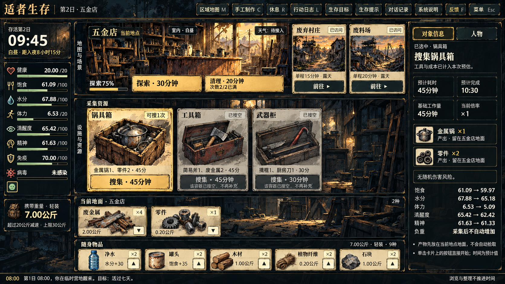

# 主界面视觉精修 v1.0

日期：2026-10-28。基于 v0.9 材质精修；本次方向已经策划确认。运行验证结果另见验收记录。

这张图只用于插画占比、纸卡构图和光影方向；文字、数值、库存、时间及布局以真实游戏状态和下列规则为准。不得将整张预览作为运行背景。

## 1 本轮目标与边界

- 保留已有做旧边框，把投入集中在插画主体、冷暖光影、卡片构图。
- 只调整美术素材、显示映射与表现层；不改玩法数值、存档、物品所有权、确认次数、时间推进或输入锁。
- 保留四区同屏、现有导航、地图方位、状态提示、卡旁操作、箭头转移、锅内信息与拖放。
- 角色造型、战斗规则及 Q14–Q22 待确认问题不在本轮裁定范围。
- 用户明确授权仅本次由 Codex 例外进行网页实装、验收与推送；不修改 AGENTS.md，也不改变以后会话的角色分工。

## 2 插画与卡片

1. 锅具箱、工具箱、五金武器箱采用独立新构图：木箱和金属锅、开盖工具箱和斧头、长箱和撬棍/刀具有不同轮廓。插画不能带文字、按钮、数量或示例状态。
2. 主体扩大、纸面中心保持干净；保留接触阴影与完整轮廓。不以拉伸、截断工具或露出相邻图集单元的方式扩大。
3. 资源卡采用名称/状态在上、插画居中、摘要与执行在下的结构。插画不再有独立内框；只给可执行主按钮和选中边缘保留暖金重点。
4. 搜空卡降低饱和度，保留辨认物件的细节和“已搜空”文字，不得只靠颜色表示禁用。
5. 地面、随身、详情继续使用同一物品素材。数量、重量、耐久、保质等继续取真实状态。

## 3 光影与背景

- 环境及非关键面板偏冷蓝灰，降低全屏统一黄褐感。
- 让场景自身的窗光与火光成为局部暖色焦点，不把每个区域都提成高亮背景。
- 纸面为低饱和米灰黄，插画与文字之下不铺高频污损。
- 右栏正文使用稳定深底，场景装饰只弱化地出现在底部。保留现有昼夜与火堆光照逻辑，不让静态装饰覆盖夜间状态。

## 4 三档布局

| 内容视口 | 原则 |
| --- | --- |
| 1280×720 | 保留紧凑横卡，扩大左侧物件，维持四区、40px 转移热区及完整锅加工控件 |
| 1600×900 | 横卡适当加高、主体扩大；把足够高度留给资源插画，避免为了竖卡挤扁地图和资源 |
| 1920×1080 | 使用较高的物品卡与更大的资源图，维持名称/插画/底部信息层次 |

预览图不构成固定像素布局要求；最终按真实内容视口检查。物品多时允许原有横滚，长详情允许右栏内滚动；不能隐藏入口或用缩小字体来过关。

## 5 验收与发布

- 五金店与含锅、净水、食材的营地三档各一张真实截图；同存档、同视口对比旧版，截图前等待字体与素材解码。
- 检查主体无拉伸/串图、文字不与插画重叠、默认/选中/搜空/键盘焦点明确；正文和关键数值可读。
- 完整验证箭头与长按转移、合法/非法拖放、点火、投木、等待烹饪、整锅/子物转移、行动退出与暂停恢复、对白输入锁、战斗一轮、刷新恢复、导航与边缘浮窗。
- 构建、适用的现有自动回归、三档真实浏览器验收均完成后，先向策划展示实际截图，再按已授权顺序推送。
- 推送后核对 GitHub Pages 的构建提交、新资源、游戏启动、代表操作及刷新恢复；未完成线上复验前不能写“已上线验证”。

本轮需求不删除或改写旧策划案的【实现同步】及修改记录。
