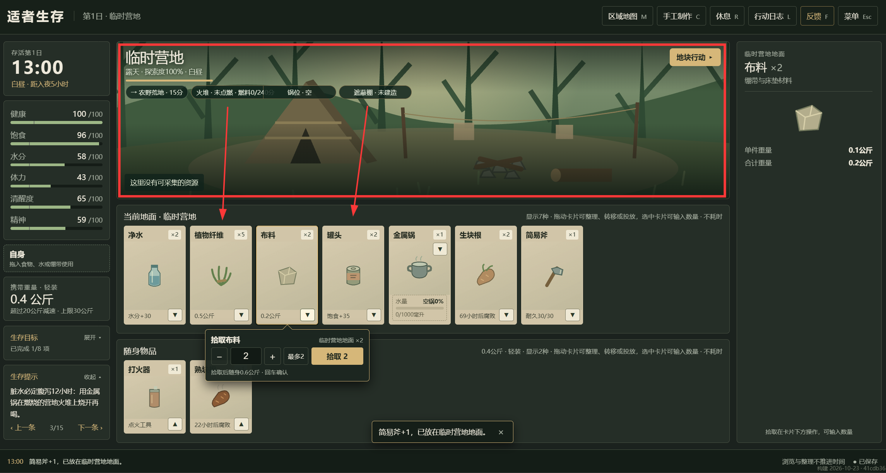
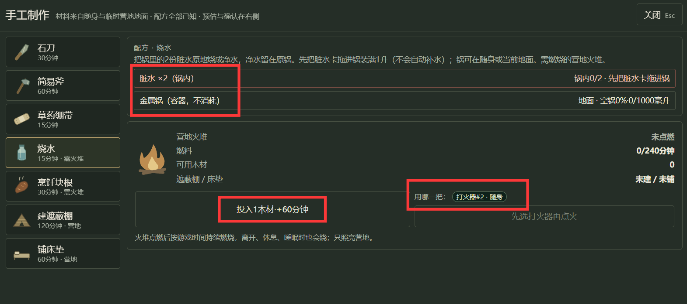

# 适者生存：需求裁定与开发交接

> **基础UI修订 v0.7（2026-10-26）：** UI交接先读[基础UI布局与操作修订案](<../基础UI交互修订 v0.7/基础UI布局与操作修订案 v0.7.md>)。地图与设施两行、内容物内嵌、点火直接提交、滚轮及自身入口按新案执行；v0.4加工玩法继续有效。配套JSON中的`ui.layout`和`ui.facilityContentsPanel`保留为历史值，不再作为最新UI指令；该JSON的玩法参数不因此废止。

策划版本：v0.4；更新日期：2026-10-24。

> 【实现同步 2026-10-24】本包已按 doc/开发计划 v0.3 卡片统一与设施烹饪.md 的 M17–M24 接入网页原型（提交 8b4d7db 至 M24 收尾提交），P401–P421 有对应内核测试，U401–U414 已在浏览器逐条走过；存档 schema 升为 "4"。实施偏差、开发假设与待确认问题见该计划第 3、4、7 节。

基线为本地已更新的基础玩法v0.2、交互与地图扩展v0.3、UI v0.1及其“实现同步”记录。本包是待接入的新策划，不将旧文档中已通过的测试结果视作本包通过。策划版本、程序实际配置文件名（已记载为data/config.v0.4.json）与存档schema各自独立，不能因名称相同而直接覆盖。

## 1. 阅读入口

1. [统一卡片与次级菜单UI策划案](<01 统一卡片与次级菜单UI策划案 v0.4.md>)：截图红框改造、设施内嵌卡片、地图卡按钮、制作菜单图标。
2. [设施内容物与烤制水煮策划案](<02 设施内容物与烤制水煮策划案 v0.4.md>)：唯一归属、转移、自动加工、食品数值与时间边界。
3. [策划增量配置](<策划增量配置 v0.4.json>)：本包新增参数与明确废止项；程序映射至现有工程，不作为旧JSON的盲目递归合并补丁。

本次不修改游戏工程。旧正文和实现同步记录保留，新增版本提示指向本包。优先级：本次用户明确需求 → 本包对应有效规则 → 旧案中未被替代的实现同步规则 → 旧正文。下列参数补齐与用户已确认要求分开记录。

## 2. 用户明确需求与有效裁定

| 编号 | 当前需求 | 有效规则 |
| --- | --- | --- |
| N1 | 地块中的地图、火堆、建筑、厨具增加图片并统一卡片样式 | 截图1红框变为统一卡片区域；对象不能只用文字胶囊表示 |
| N2 | 入火堆的锅显示在火堆卡内，可拖拽/点击转移，也能继续向锅投物 | 锅真实归属改为火堆内容物；原地面/随身卡消失；火堆内保留该锅独立命中区与内容物 |
| N3 | 移除地块行动按钮，地图卡内放探索和清理；满探索移除探索按钮 | 移除旧地块行动菜单入口；仅当前地图卡提供探索/清理；100%不渲染探索按钮 |
| N4 | 明火烤食物，有水锅水煮，空锅不能烹饪，效果略不同 | 首版支持生块根的两条路径；保留cooked_root作为烤熟块根，新增boiled_root水煮块根 |
| N5 | 手工制作等次级菜单所有物品表达增加图标 | 材料、产物、催化工具、投料和打火器选择均为图标+名称+数量/状态 |

沿用上次用户裁定：点火始终绑定具体打火器，按钮必须点选、拖入则绑定该实例；随身及当前地面打火器都可用；不自动倒出锅内物品；取消所有自动补水；设施内容物随游戏世界时间自动加工；行动预测在右栏实时显示。

## 3. 与最新版旧案的冲突及处理

| 最新旧案中的规则 | 本包替代规则 | 原因与接入影响 |
| --- | --- | --- |
| 地名/地块行动打开覆盖地点栏的行动菜单 | 探索/清理直接位于当前地图卡；移除地块行动入口 | 最新N3覆盖上次B4的入口位置；点击直接执行及右栏预测保留 |
| 100%探索按钮禁用但可见 | 100%隐藏探索按钮，保留已充分探索文字 | 不只灰化；玩法层仍拒绝过期请求 |
| 锅在地面栏显示“已架在火堆上”，锅位只是关联 | 入设施后只在该设施内显示，真实owner变设施 | N2；迁移去除双重可见/双重归属 |
| 空锅+两份生块根作为主动30分钟配方 | 生块根入明火烤制；入有水锅水煮；空锅不处理 | N4；厨房加工从角色主行动转为设施进程 |
| 烧水必须主动开始，必须装满1升 | 入燃烧火堆的锅有脏水就自动处理，0.5或1升均15分钟 | 设施自动处理；取消自动补水后不强迫凑满，不替玩家取水 |
| 锅不保存固体内容，原料只做预留引用 | 锅实际保存最多2份可煮食材/成品及水 | 内嵌卡必须有真实数据，不使用装饰副本 |
| 锅在随身或地面也可远离锅位加工 | 只有属于燃烧火堆加工位的锅可受热 | 锅携带/放地上只是存放，不能隔空加工 |
| 单主行动占用烧水/烹饪，熄火需手动继续加工 | 烧水/烹饪为设施自动进程，复燃后自动恢复 | 不占角色主行动，角色的暂停与继续规则另行保留 |
| JSON v0.3仍有buttonAutoFill字段 | 废止该字段及功能；请求中不得创建缺少的水 | 已更新文字与旧设计JSON不一致；不得按旧JSON恢复自动补水 |

本包只将厨房处理改为设施进程，石刀、斧、绷带、建棚、床垫仍是角色制作/建造行动；清理概率、次数恢复和探索里程碑不改。

## 4. 本次补齐的首版参数

这些是为开发闭环补齐的可调初值，不称为用户原话或原作准确参数。

- 营地火堆共2个加工位，最多容纳1口锅；一份直烤食材占1位，一口锅占1位，锅内容不再占火堆额外位。
- 每锅水容量仍1升，按0.5升单位转移；增加2个食材位。空锅允许存放生块根，但状态明确为“缺水，未加工”。
- 脏水0.5或1升均需15个有效受热分钟；烤制和水煮每份生块根均需30个有效受热分钟。
- 每份水煮食材需预留并在完成时消耗0.5升净水。锅内有2份食材但只有0.5升时，按实例ID先供一份，另一份等水；不自动补水。
- 烤熟块根：饱食+25、水分−2、精神+2；水煮块根：饱食+23、水分+5、精神+3。两者每份0.3公斤，24小时保质，食用均5分钟。
- 生块根是现有物品中首批可烹饪原料；罐头、野果、草药、水、熟食和材料不因泛称“食物”而自动新增烹饪配方。

对旧数值的影响：原熟块根每份未设额外水分消耗，现在烤制每份额外−2水分；旧基础求生案“两份熟块根+三份净水”的示例需把烤制额外−4计入，不能继续照搬原水分余量。水煮的加工用净水也应计入出行储备，而非只统计食用后的+5水分。

## 5. 必须保留的已有实现约定

固定对象不能被拖走或排序；暂不新增筛选、触屏或自动排序。物品拖拽默认1份、Shift数量框、同区整卡排序保留。锅/工具按实例显示；其他物品可按种类归组，但底层批次和保质期不可丢失。

点火仍耗5分钟，打火器不消耗；燃料0时可沿用现行“有木材自动投入1份”的点火规则，这与取消自动补水是两回事。点火预览必须显示将消耗木材1。燃料1—4分钟拒绝点火；手动投料每份60分钟、上限240、整份容量校验保持。

单主行动、最多一个补给/维护子行动、执行中不允许实体转移、移动途中只用随身物品、30公斤拾取上限、PRNG和requestId幂等、离线不推进时间均沿用。设施进程不构成第二个角色主行动。

## 6. 存档与开发交接

基线文档记载存档schema为字符串"3"、网页单槽与备份键。本包建议升级为"4"，迁移前保留原档；程序若已有后续schema，应选未占用版本并记录映射，不能覆盖已有版本含义。

迁移规则：已附着锅从原随身/地面owner转为facility:<火堆实例ID>；保留锅ID、水和到期时间，移除原区域布局索引；每口锅只能出现一次。普通旧cooked_root保留ID与剩余寿命，新食用效果按本版。旧活动烧水可将已完成工作分钟转为同锅设施进程，先把锅移入其原营地火堆，释放角色主行动；不补水、不生成净水。旧活动烹饪尚未完成时取消旧配方，将原预留生块根一次返还当前地面并提示改用新烹饪方式；不自动放进火堆，不补发熟食。旧已完成结果不重复处理。

若已有附着锅与旧活动烧水引用不同锅、同一物品多owner、或火堆容量无法容纳，应暂停迁移并报告冲突、保留原档，禁止凭默认排序挑一把锅或丢弃内容物。迁移完成标记已写入，读取新档不重复返还或转移。

程序交付需提供内核与界面验收证据；本次只检查文档/配置，不声称已验证Claude工程。工程中的GameEngine.Drop、ResolveDrop、DropIntent、ItemShelf、LocationStrip、CraftOverlay、PreviewView等可复用；新增语义按实际类名映射，避免另建第二套点击与拖拽规则。

## 7. 参考截图与设计依据

用户截图1，红框为本次地块卡片区改造范围：

用户截图2，红框内材料、工具、投料与选择项均需图标化：

[《奇幻森林》开发者烹饪更新](https://steamcommunity.com/app/2868860/allnews/)的Cooking Improvements Update and Patch Notes #58说明容器内食物受热处理及烹饪设施容量机制。本包借鉴“内容物+条件+时间”的思路；原作后续使用重量容量，本项目首版采用上述明确加工位，并不宣称与原作完全相同。两种块根数值为本项目设计。
