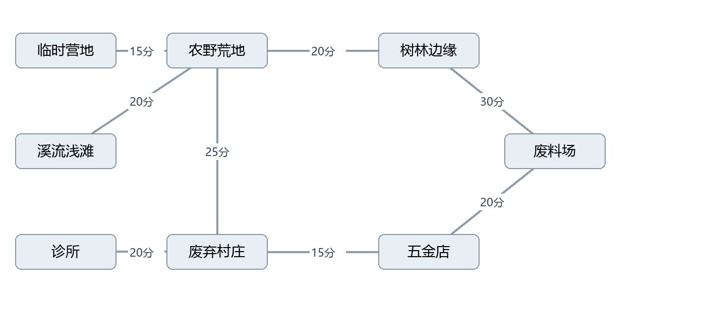

# 适者生存地图系统策划案

基础系统 v0.2   |   2026年10月21日   |   三人团队单机原型

本版采用地点卡、资源点卡和物品卡呈现末日单人生存。三份系统案共同定义“发现地点 → 移动探索 → 定向搜集 → 搬运加工 → 补给休息 → 再次出发”的基础循环，供策划与开发直接拆分任务。

本次优先级高于旧版范围案中的对应规则：暂停侵蚀、轮回、超能力、善恶值、招募和联机；同时暂不接入战斗。取消10日硬终局，改用7日生存检查目标，达成后可以继续游玩。

统一使用游戏内分钟推进时间，替换每日12行动点。配置值为本项目原型建议值，可调但不能由开发各自补定。时间与状态由基础求生案负责，地图和搜集系统通过同一行动流程调用。

> 实现同步（2026-10-23）：本文已按网页原型的当前实现同步。标有【实现同步】的句子是按实际规则改写或补充的；被《交互与地图扩展 v0.3》覆盖的条款只加注、不删原文。改动汇总见文末「实现同步记录」。

## 从参考作品提取的设计关系

热带岛屿的官方介绍确认，卡牌组合承载探索、采集和制造；官方画面将地点入口、场景对象、携带物和身体状态并列显示。奇幻森林延续这一交互方式，官方介绍进一步强调生态、季节和环境对生活的影响。[S1][S2]

据此，本项目将“地点里有什么、去哪里、能带回什么、付出多少时间和身体消耗”放在同一决策流程内。生态种群与四季模拟先搁置，首版用固定资源补充、昼夜和地点暴露属性表达环境约束。该简化是本项目的实现选择。

## 交付范围

| **项目** | **本版约定** |
| --- | --- |
| 地图结构 | 8个地点，8条双向连接；无坐标移动与程序生成。 |
| 发现机制 | 探索度永久累积，里程碑解锁路线与资源点。 |
| 环境信息 | 室内或露天、昼夜；暂不做天气、温度与季节模拟。 |
| 实施顺序 | 先做时间和地点移动，再做探索解锁，最后接入搜集与状态消耗。 |

参考画面用于理解交互与信息层级，后续规则和数值均为本项目设计，不代表两作的内部公式。画面与资料检索日期为2026年10月21日。

[S1 热带岛屿官方介绍与商店截图](https://store.steampowered.com/app/1694420/Card_Survival_Tropical_Island/)

[S2 奇幻森林官方介绍与商店截图](https://store.steampowered.com/app/2868860/Card_Survival_Fantasy_Forest/)

[S3 奇幻森林开发者公告官方数据源](https://api.steampowered.com/ISteamNews/GetNewsForApp/v2/?appid=2868860&count=20&maxlength=0&feeds=steam_community_announcements)

## 01 热带岛屿画面与系统观察

图1 官方海滩画面：顶部可见Beach、Jungle Outskirts、Rocks等地点与对象；左侧有天气、日时与状态条；下方物品显示数量或状态。观察结论：地点与资源不是独立菜单，环境和身体信息伴随每次行动出现。

图2 官方雨林画面：可见Unsafe Water、背包、衣物、食物以及多种状态标记。观察结论：找到资源以后仍存在安全加工、携带与身体管理问题。截图只证明信息呈现，不用于推断未公开的数值或概率。

[图1与图2来源 WinterSpring Games 热带岛屿官方商店图集](https://store.steampowered.com/app/1694420/Card_Survival_Tropical_Island/)

## 02 奇幻森林画面与系统观察

图3 官方河岸画面：Mossy Bank、River、Campfire、Improvised Shelter、Oak Tree与Reed Patch并列；下方可见鱼、石块、叶片和携带工具。观察结论：移动入口、固定设施和可采资源共存于地点内，资源需要结合用途与加工链理解。

图4 官方室内画面：Mud Hut、Fireplace、Table、Log Bed和Shelf构成居住场景，工具与食物显示不同状态。结合官方生态与身体模拟介绍，可将其理解为生存网络的扩展。本项目只先实现固定营地、火堆和简易休息条件。[S2]

[图3与图4来源 WinterSpring Games 奇幻森林官方商店图集](https://store.steampowered.com/app/2868860/Card_Survival_Fantasy_Forest/)

## 03 参考玩法系统拆解

两作的卡牌首先承载对象、状态与可执行动作。玩法判断来自一组相互制约的系统：移动扩大可用资源，搜集取得原料，加工改变资源用途，身体需求推动补给和休息，工具与居住条件再改善后续行动。以下为官方介绍与画面所支持的结构归纳。[S1][S2]

| **维度** | **热带岛屿** | **奇幻森林** | **本项目先实现** |
| --- | --- | --- | --- |
| 探索环境 | 多种岛屿环境。 | 森林分区与不同生境。 | 固定地点图与发现进度。 |
| 资源关系 | 自然材料与加工用途。 | 生态与四季影响生活。 | 植物日补、遗迹有限。 |
| 加工生产 | 工具、烹饪与居所。 | 多工种制作与建造。 | 少量配方和固定营地。 |
| 角色模拟 | 伤病与心理等细节。 | 消化、免疫与精神。 | 六项基础状态。 |
| 成长来源 | 技能、工具与设施。 | 工具、工艺与品质。 | 工具效率与恢复改善。 |
| 长期生活 | 储水、农耕与饲养。 | 季节与多类生产。 | 七日检查与持续生存。 |

### 三套基础系统怎样互相推动

地图决定资源分布和往返成本；搜集决定一次行动的可预期收益，以及物资能否被携带和保存；求生决定玩家能持续工作多久、何时该补给与睡眠。营地加工与恢复让下一次探索产生不同准备选择。

### 本版采取的简化

资源池与里程碑采用固定配置，便于三人团队复现问题；身体伤害保持直接可解释；工具加成不依赖技能等级。森林生态、季节、农耕、养殖和复杂生理只作为后续扩展方向，不能成为本版基础饮水与食物获取的前置条件。

### 参考证据的边界

截图可验证卡片布局、可见物品和状态呈现；官方介绍可验证系统范围。以下探索阈值、固定产出、分钟数、概率、状态速率和库存规则是本项目建议值，并非从截图还原出的原作公式。

[S1 热带岛屿官方介绍与商店截图](https://store.steampowered.com/app/1694420/Card_Survival_Tropical_Island/)

[S2 奇幻森林官方介绍与商店截图](https://store.steampowered.com/app/2868860/Card_Survival_Fantasy_Forest/)

[S3 奇幻森林开发者公告官方数据源](https://api.steampowered.com/ISteamNews/GetNewsForApp/v2/?appid=2868860&count=20&maxlength=0&feeds=steam_community_announcements)

## 04 地点结构与地图连接

世界按“区域 → 地点 → 资源点或固定设施”组织。首版只开放一个区域；地图节点代表整个地点，角色同一时刻只位于一个地点，不能在地点内行走。资源点可具有自己的数量、使用状态和发现条件。

| **连接** | **基础单程时间** | **解锁条件** |
| --- | --- | --- |
| 临时营地 ↔ 农野荒地 | 15分钟 | 开局解锁 |
| 农野荒地 ↔ 溪流浅滩 | 20分钟 | field达到25 |
| 农野荒地 ↔ 树林边缘 | 20分钟 | field达到50 |
| 农野荒地 ↔ 废弃村庄 | 25分钟 | field达到100 |
| 废弃村庄 ↔ 五金店 | 15分钟 | village达到50 |
| 废弃村庄 ↔ 诊所 | 20分钟 | village达到100 |
| 树林边缘 ↔ 废料场 | 30分钟 | woods达到100 或 scrapyard达到100 |
| 五金店 ↔ 废料场 | 20分钟 | hardware达到100 |

一条连接解锁后双向有效，并在地图上显示终点的待访问卡片。解锁不等于已经到达；所有连接长度以基础分钟表示，实际耗时还受昼夜、负重和体力影响。未解锁连接不能通过地图点击绕过。

## 05 地点与资源点发现表

| **地点ID与名称** | **场景属性** | **探索里程碑** |
| --- | --- | --- |
| camp 临时营地 | 露天 | 初始已访问 |
| field 农野荒地 | 露天 | 25溪流 50树林 75无新增 100村庄 |
| stream 溪流浅滩 | 露天 | 25无新增 50草药 75无新增 100无新增 |
| woods 树林边缘 | 露天 | 25木材 50石块 75野果与纤维 100废料场 |
| village 废弃村庄 | 露天 | 25补给箱 50五金店 75杂物箱 100诊所 |
| hardware 五金店 | 室内 | 25无新增 50锅具箱 75工具箱 100废料场 |
| clinic 诊所 | 室内 | 25药柜 50布料包 75无新增 100无新增 |
| scrapyard 废料场 | 露天 | 25金属堆 50零件箱 75无新增 100通往树林 |

### 入场时已知的内容

营地探索度为100，开局已访问，固定火堆可见。进入农野荒地即显示块根与纤维；进入溪流即显示脏水源。其余资源点按上表的探索里程碑显示，具体产出与数量由物资搜集案管理。

### 地点状态

未知：地图不显示名称和入口。已发现：显示名称、入口与已知单程时间，细节标为待访问。已访问：展示场景、探索度、当前地面物品与已发现资源。已充分探索：探索度100，仍能移动、采集和管理物品，但不能再获得探索进度。

状态推进单向且永久保存，不因离开、跨日或读取存档降低。移除旧案“现实每日减少20%探索度”的规则。自然资源补充独立于探索度，遗迹容器不会因探索度变化而重置。

## 06 探索行动与里程碑结算

### 探索操作

在当前地点点击地点卡，选择“探索周边”。基础耗时30分钟，成功完成增加25探索度；营地及探索度100的地点禁用该行动。【实现同步】每次有效完成除推进探索度外，另按当前地点的共享掉落表抽取一次零散物资（可能为空），产物落在当前地面，不自动拾取；规则见《交互与地图扩展 v0.3》03 案。玩家随后对已发现资源点执行定向搜集，或用“清理”再取零散物资（02 案）。

开始前显示预计耗时、体力与水分预计变化，以及本次将跨过的已知里程碑。未知的奖励内容可显示为“发现新线索”，但不会让玩家误以为每次探索都必有物品。

### 执行流程

校验当前地点和探索度 → 建立带唯一ID的行动 → 逐5分钟推进时间与身体状态 → 完成时增加进度 → 按25、50、75、100顺序处理新跨过的里程碑 → 更新地图和地点卡 → 自动保存。

探索取消、角色死亡或行动未完成时，不增加探索度；已流逝时间与身体消耗保留。一个里程碑只触发一次，解锁记录按“地点ID与阈值”保存，不能通过反复进入地点重复发奖。

### 具体例子

| **初始状态** | **行动** | **预期结果** |
| --- | --- | --- |
| 农野荒地0，白昼、轻装、体力充足 | 探索30分钟 | 探索度25，解锁溪流；另抽一次随机物资，可能为空【实现同步】。 |
| 农野荒地25 | 再探索30分钟 | 探索度50，解锁树林；溪流不重复解锁。 |
| 村庄50 | 探索完成至75 | 显示杂物箱，箱子仍须另花时间搜集。 |
| 树林75，探索中途取消 | 已过去10分钟后取消 | 保持75，不解锁废料场；保留10分钟消耗。 |
| 诊所100 | 点击探索 | 按钮禁用，不扣时间，不生成新资源。 |

每个地点的里程碑表是固定配置。没有新内容的阈值仍推进探索度并记录，不需要生成填充事件。首版无探索经验、随机解锁顺序或隐藏地图概率。

## 07 移动与环境规则

### 单连接移动

玩家只能移动至当前地点已解锁的相邻地点。选择入口后显示基础时长、按当前条件估计的到达时间、当前负重以及入夜提示；确认才启动。角色位置在行动完成时一次更新，移动过程中不允许访问目标地点的物资。

首版无自动多地点寻路、传送或快速回营。地图可以显示已发现连接，跨多地点行动由玩家逐段确认。取消移动时回到起点，保留已经消耗的时间和身体变化，不能在半途拾取任何一端的物资。

### 共享时间修正

夜间无照明时，移动、探索与搜集的速度修正为1.5；携带总重超过20公斤时再乘1.25；体力低于20时再乘1.25。修正乘积上限2.0。每5分钟按当时条件推进工作量，详细公式以基础求生案为准。

昼间为06:00至18:00，夜间为其余时间。室内地点仅改善睡眠条件，不自动提供照明；本版无便携照明，火堆只能照亮其所在地点。跨入夜间时，后续时间段重新计算修正，预计到达时间需随之更新。【实现同步】移动始终按无照明计算；探索、清理、搜集、制造在火堆燃烧的地点不吃夜间系数。地点场景图的清晨、黄昏变色只是画面，规则上的昼夜仍以06:00–18:00为准。

### 室内和露天

五金店和诊所为室内，允许按遮蔽条件睡眠；其余地点为露天。营地完成遮蔽棚后，也允许遮蔽睡眠。首版室内不产生跨地点容器、门锁、独立房间地图或环境温度数值。

### 边界与持久化

午夜只推进天数和资源补充，不终止移动。中途健康降至0则结束本局，角色死亡地点记为移动起点；行动终止，不移动到终点。地图、资源、设施及地面物品都按地点独立保存，离开不卸除其时间模拟。

## 08 界面与数据约定

### 界面布局

【实现同步】左侧常驻日时、昼夜、六项状态、“自身”投放卡、负重、可折叠的生存目标与生存提示；上方地点行采用场景聚焦（UI 案 B 方案）：地点场景图铺满整行并随游戏时刻变色，左上为地点名、探索度、相邻入口与火堆、遮蔽棚标签，右上为“地块行动”按钮（【实现同步 2026-10-24】点它或点地名弹出盖住地点行的次级菜单，探索与清理在菜单里点击即开始，指向哪个按钮右栏就显示哪个行动的预测），已发现资源点卡叠在场景下方；中间为当前地点地面物资；下方为随身物品；右侧为选中对象的预估与确认。支持点击卡片选择操作；卡片也可拖动（整理、转移、投料、装水、组合），拖拽与按钮调用同一条玩法指令，不能绕过条件校验。

资源点卡显示剩余量、是否可补充及下次补充时点，并带直接开始的“采集/搜集”按钮；地点行显示探索度，探索与清理在“地块行动”次级菜单里点击即开始【实现同步 2026-10-24】；入口卡显示名称与基础时长。地图总览只负责路线信息，当前地点操作仍在主界面完成。【实现同步】地图总览打开在中部，右栏显示所选相邻地点的移动预估与确认，视野按已发现地点自动缩放。

| **配置或状态** | **字段及要求** |
| --- | --- |
| LocationConfig | id，name，exposure，initialProgress；id不可重复。【实现同步】里程碑由 edges[].unlockAny 与 resources[].revealAt 推导，不单独存；另有 scene、sceneFireX、sceneFireY（场景图）、lootTableId、clear（v0.3）。 |
| EdgeConfig | id，from，to，baseMinutes，unlockConditions；双向连接只存一条。 |
| LocationState | discovered，visited，progress，triggeredMilestones，groundItems，facilityStates；【实现同步】clearCharges，clearRefillProgress，clearUpdatedMinute（清理次数，v0.3）。 |
| WorldState | schemaVersion，gameMinute，currentLocation，edgeUnlocks，activeAction。 |
| ActionRequest | actionId，type，sourceLocation，targetId，baseWorkMinutes；开始时锁定目标。 |

### 显示与错误反馈

未解锁：显示“尚未发现路线”。相邻条件不符：提示“请先前往相邻地点”。行动中：禁用重复提交。探索已满：提示“已充分探索，可清理或搜集已发现资源”【实现同步】。地图上只显示玩家已知信息，开发调试面板可单独展示全部节点和状态。

所有输入由统一行动入口处理，地图只提交目标与基础耗时，不自行扣状态、不维护另一套时间。读取旧v0.1存档不要求兼容。【实现同步】存档带 schemaVersion（当前为 3）；首版原型存档 0.2-proto-1 读取时先备份原文再自动升级，其他版本明确拒绝并允许新游戏。

## 09 地图验收与实施顺序

| **编号** | **测试** | **通过条件** |
| --- | --- | --- |
| M01 | 新游戏查看地图 | 仅营地已访问，农野荒地已发现；其他名称隐藏。 |
| M02 | 荒地探索四次 | 按25、50、100顺序解锁溪流、树林和村庄；75无新增。 |
| M03 | 村庄探索到75并回营再来 | 杂物箱只发现一次，未搜集前内容保持不变。 |
| M04 | 尝试从营地直接进入五金店 | 不移动、不扣时间，提示路径条件。 |
| M05 | 解锁废料场的两条不同入口 | 达到任一对应条件仅解锁该连接；不凭终点已发现解锁其他边。 |
| M06 | 移动10分钟后取消 | 位置为起点，时间与状态保留，终点不能提前取物。 |
| M07 | 充分探索后跨越三天 | 探索度不变；自然资源由搜集案补充，遗迹箱不重置。 |
| M08 | 移动跨18:00与00:00 | 速度与昼夜切换正确；午夜后继续行动，完成才更新地点。 |
| M09 | 保存读取当前行动与地图 | 进度、连接、里程碑和当前位置一致，不重复解锁。 |

### 建议实施顺序

第一步：用占位卡实现8节点与连接解锁。第二步：实现移动及共享时钟。第三步：增加探索度与里程碑。第四步：接入地面物品、资源点与设施。最后制作卡片反馈与地图总览。每一步均可用固定数据独立验收。

### 适用边界

本案不包含程序生成大地图、遭遇战、NPC、天气生态或任务分支。这些内容可在基础循环验证后增加，但不会改变地点ID、资源点ID和统一时间入口的含义。

## 实现同步记录（2026-10-23）

依据：网页原型提交 af343da 至 e6acaf3、doc/实施方案 v0.1.md 第 9 节、doc/开发计划 v0.1.md 第 6 节、doc/开发计划 v0.2 交互与地图扩展.md 第 8 节、试玩留言 8f9a7c9b 与 649cdad9。

| 条款 | 原文 | 现状 | 来源 |
| --- | --- | --- | --- |
| 06 探索操作 | 探索只负责发现，不发放物品 | 完成时另按共享掉落表抽一次零散物资；新增“清理”行动 | 交互与地图扩展 v0.3 02、03 案 |
| 07 共享时间修正 | 夜间无照明修正 1.5 | 移动始终无照明；其他工作在火堆燃烧的地点不吃夜间系数 | 实施方案 9B.2 |
| 08 界面布局 | 上方为地点卡、入口卡及资源点卡 | 地点行改为场景聚焦（B 方案），场景按时刻变色；探索、清理、采集为直接开始的快捷按钮；卡片可拖动 | 留言 8f9a7c9b-3、649cdad9-1；提交 3e10538、7cd6321、63bfd32 |
| 08 界面布局（2026-10-24） | 探索、清理按钮并排在地点行右上 | 改为“地块行动”次级菜单：盖住地点行，点击即开始，指向即在右栏预测 | 策划答复 B4；提交 1f586f1 |
| 08 显示与错误反馈 | “请先到达相邻地点”“已充分探索，可继续搜集” | “请先前往相邻地点”“已充分探索，可清理或搜集已发现资源” | 代码 GameEngine.Validate |
| 08 存档 | v0.2 原型存档拒绝不兼容版本 | schema 3；0.2-proto-1 备份后自动升级，其他版本拒绝 | 提交 38e7239 |
| 08 数据字段 | LocationConfig.milestones | 里程碑由 edges.unlockAny 与 resources.revealAt 推导；新增 scene 与清理字段 | 实施方案第 3 节、开发计划 v0.2 第 3 节 |

docx 原件已于 2026-10-24 删除（此前未入库），以本 Markdown 为准。
