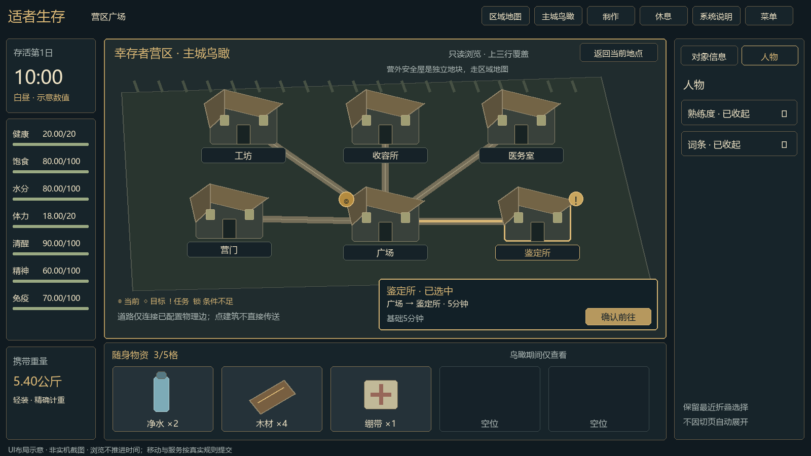
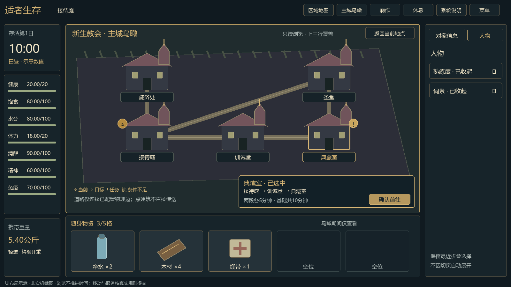
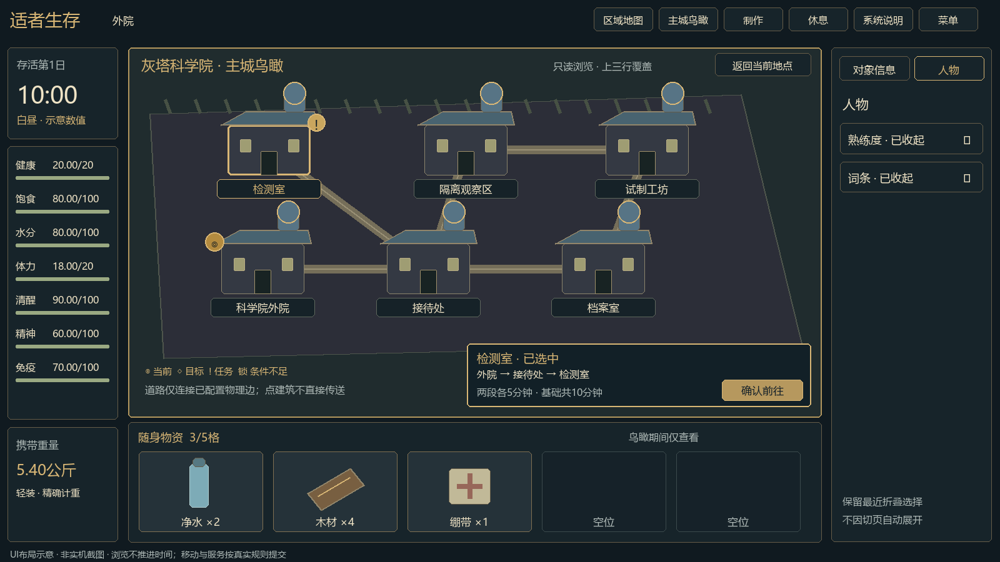
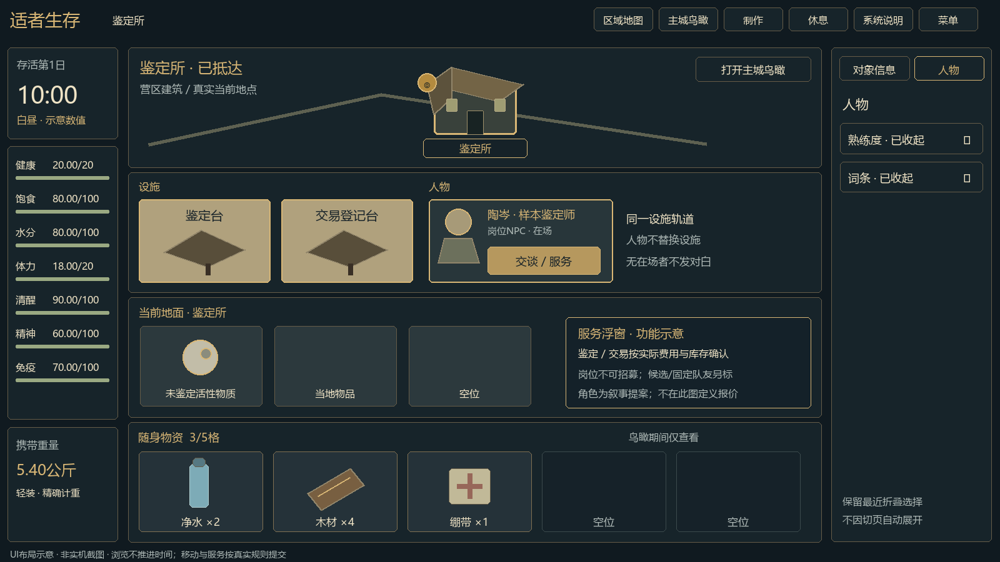

# 全屏战斗、装备技能与队伍地图UI规范草案

## 2026-10-31 Q43答复：开战默认武器页（当前优先）

用户选A；[本轮更新说明](<../更新说明/2026-10-31/Q43 更新说明.md>)。本节取代R03旧B3“开战固定从Ⅰ页开始”及R02/A10未明确默认页的范围；保留原开发【实现同步】及修改记录，不据此重写已发生的实现证据。

| 武器Ⅰ实际占用 | 武器Ⅱ实际占用 | 新战斗初始显示 |
| --- | --- | --- |
| 有装备实例 | 任意 | Ⅰ页 |
| 空 | 有装备实例 | Ⅱ页 |
| 空 | 空 | Ⅰ页（拳） |

占用仅按真实装备owner/槽实例判定，不按耐久、弹仓、命中率、攻击强弱排序。Ⅰ已损坏/无弹而Ⅱ可攻击时仍默认Ⅰ，显示原不可用原因，玩家可切Ⅱ；坏/无弹不是空槽，不自动变拳。两槽满时不额外显示普通徒手页，Q39原低体力应急例外不扩大。未来多角色按各角色自己的槽位分别应用，不借用队友武器。

接近敌人/开战确认浮窗使用同一角色、同一实时装备状态与同一个默认页选择规则来计算命中率及武器相关预测，不能预览拳却开战选Ⅱ武器。敌踪待选时依Q42合法换装后，预览及时刷新；实际确认仍重新校验，不沿用旧装备结果，也不重抽敌人或结果。

默认选择仅在新战斗首次初始化时执行，0游戏分钟/0AP，不消耗E/耐久/弹药、不自动攻击、不新增武器实例或改owner。战斗中按原两页切换规则操作；敌方行动展示中可切页查看但不可越过角色行动权限提交指令。打开界面、切激活角色/展示或读档不再次抢回默认页：已有合法当前页按战斗存档恢复；仅缺失/非法页按旧档兼容初始化，不补奖励或攻击。

验收BT-Q43-01：Ⅰ有/仅Ⅱ有/双空三类默认与接敌预览一致；BT-Q43-02：Ⅰ坏/无弹且Ⅱ有效仍默认Ⅰ且原因真实、可手动切Ⅱ；BT-Q43-03：敌踪前合法换装刷新预测、新战斗重验，不自动攻击/消耗；BT-Q43-04：手动切页后保存刷新、开关界面及敌方展示不覆盖已存页，0AP/原输入锁与Q39仍有效。均为开发回归目标，本次未重新运行游戏工程。


## 2026-10-31 Q38—Q42联动

七槽先在右栏人物页装备折叠区，完整整备面板延B10；未来面板入口复用当前同一领域校验。地面卡可直接选择已开放相容槽，交换旧件去向明示，默认回本人包，满格须明确落地或取消。低屏可在右栏内滚动，战斗装备只读，两槽满不额外徒手页；行动中仅本人未锁物调整，地面取放保持原锁。

完整边界与EQ-B3验收见S06/R02/A05；[本轮更新说明](<../更新说明/2026-10-31/Q38-Q42 更新说明.md>)。原开发注记保留，不声称新地面穿戴已实现。

> 【实现同步 2026-10-31】（开发计划 v0.9 批次 B3a，提交 5cbfa22、c463905）选中当前地面的武器卡，卡下操作浮窗给“装备到武器Ⅰ/Ⅱ”，每个可点的槽下常驻“装备后本人X公斤 · 随身N/5张 · 换下××#N回随身”；旧件回随身放不下时原按钮禁用写原因，另给“装备到武器Ⅰ·旧件××放当前地面”，不点即取消；没有新增拖拽落点。随身武器卡在行动进行中、敌踪待选时也显示装备按钮。右栏装备区每件武器三行：名称#实例号、耐久/弹仓（木弓写随身箭矢数）/重量、卸下（满卡时另有“放当前地面”）小按钮；禁用按钮去底色、灰字、虚线框，卡下禁用的装备按钮灰底灰字并减淡；战斗中装备区只读不给按钮。战斗Ⅰ/Ⅱ页签在敌方行动展示中也能切换查看；开战停在第一个有武器的页（待确认 Q43）。“整理同类型武器”与“整理随身物品”窗按 Esc 打开菜单再关回后保留已选。界面待线上试玩复验。


## 2026-10-31 Q37答复：低屏竖卡主按钮与卡宽

用户选A接受开发现状；[本轮更新说明](<../更新说明/2026-10-31/Q37 更新说明.md>)。本节细化Q36及UI-B2-36a，不改原B2a实现注记/历史记录：

- 屏高≤800px：资源、敌踪、相邻地点卡保持上方主图/下方信息。主按钮（采集/接敌/前往）在主图右侧同一行的独立区域，不与主图重叠，不把整张卡改成左图右文横卡。低屏资源卡宽166px，敌踪/邻地190px，不使用旧236/280px宽横卡。
- 1280×720接受主图主体高/卡高约0.38—0.52，取代原Q36低屏0.35—0.45作为本类当前已接受区间；比例是实际可读布局结果，不通过裁主体、缩字、角标压图或隐藏关键风险凑数。③④行物品卡约50%目标与竖排标签/左栏元信息规则保持。
- 状态/产出可一行明确省略；风险及不能开始的原因最多两行显示，风险/禁用提示不可消失，完整内容在悬停或键盘聚焦提示及选中对象详情中可查。无悬停设备可点选看完整详情，读取提示/详情本身不执行游戏动作；真实行动仍明确确认并走原校验。
- 屏高≥801px时主按钮仍在下方信息区右侧；800/801切换不改当前选择、所选批次、折叠偏好、owner或世界时间。火堆/锅复合布局和未来全屏战斗布局仍沿各自主案。

验收UI-B2-37a：1280竖卡/独立按钮/166与190px及完整主图；UI-B2-37b：长状态、长风险/禁用原因可见且全文通过鼠标/键盘/点选详情可达，提示不点穿；UI-B2-37c：800/801切换及1600/1920按钮回信息区，选批/折叠/四行和原开始校验不回滚。三项为开发回归目标，本会话仅确认设计与文档，未重跑线上界面。

> 【实现同步 2026-10-31】Q37 选 A，与 B2a 现状一致，未改代码（开发计划 v0.9 批次 B3a 核对）：屏高≤800 资源卡 166px、敌踪/相邻地点卡 190px，上图下文，主按钮在主图右侧同一行不压图；≥801 按钮在信息区右侧（提交 a7bfa87、7af562c）。


## 2026-10-30 开发B2答复：Q34—Q36小屏布局（当前优先）

本节为用户明确选择B/A/B后的开发目标，取代旧70%目标在紧凑尺寸下的硬性达标解释，及S14“截图复核”§B同日【实现同步】中③④横向标题、低屏资源/敌踪/相邻地点左图右文的冲突展示范围。原实现注记和修改记录原文保留，未宣称本次调整已实现。

### Q34：③④行竖排标签与元信息

③当前地面与④随身物资改为竖排行首标签，复用①②行的窄行首区域，不再单独占一条横向标题/元信息带；四行轨道继续等高，不能扩大③④去挤①②。当前地点名称由第一行场景保留，③的标签/可聚焦说明可显示完整区域语义，不另占整条标题。

携带总重量（公斤两位）、负重状态与实际N/5格合并到左侧当前角色携重摘要，作为唯一常驻数值来源；切角色、食用、放下、拾取、穿戴、选批/拆并和旧档整理后按真实数据刷新。批次数/最前批到期仍在对应叠卡与详情显示，不把视觉堆叠当少占格。元信息不移出屏幕、不藏在关闭菜单，左栏不够时精简重复标签而非删数字。

1280×720预计回收约30逻辑像素供卡面使用，物品主图主体高/卡高目标约0.50；这是设计预估，需要实测，不作为本会话已达到的结论。1600/1920有空间时继续趋近原约70%。不新增强制50%或70%的硬门槛去损害主体完整、安全边距或字大小。

### Q35：次要信息与紧凑模式

沿现有响应式分界，屏高≤800逻辑像素为紧凑模式：锅实例编号/单锅重量、直烤加工位编号等次要小字可以收起；悬停或键盘聚焦可读完整提示，选中后对象信息也必须有等价全文。触屏/无悬停时可通过点选查看，不因布局引入新的游戏操作或消耗。物品长名可一行明确省略，并提供全名。屏高≥801恢复正常常驻方式。

风险、无法开始原因、真实数量/所选批次、关键火/锅/保质状态、确认执行的费用与时间仍按原位置/就近确认明确可见；不能都塞进提示。全角色总携重/负重状态/占格保持左栏常驻，不能因允许隐藏单锅重量而删总负重。切尺寸只重排，不清选择/批次/人物折叠，不重新抽随机或推进时间。

### Q36：普通资源/敌踪/邻地卡固定竖向信息结构

屏高≤800时资源卡、敌踪卡、相邻地点卡仍为上图下文，撤销该范围内低屏左图右文/约236px宽横卡的目标。接受1280主图主体高/卡高约0.35—0.45，以完整主图、可读名称/状态/按钮及安全区为先；不为70%扩大卡宽、缩字、把效果压图或隐藏危险。卡宽沿本类正常竖卡与可用空间确定，不另发明一个必须统一的像素值。

高屏仍上图下文并尽量约70%；真实内容超量可沿原分区局部滚动，但本次不以改成宽横卡制造更多横滚。火堆/锅等复合设施保持真实槽位与操作，未来全屏战斗的四站位/指令布局不受普通卡纵向规则改写；不恢复旧两行战斗目标。

### 新验收目标（开发自行执行）

| ID | 场景 | 通过要求 |
| --- | --- | --- |
| UI-B2-34a | 三档打开③④、空/满/混批/长名 | 竖排行首标签，四行等高，横向标题带已释放，无标题截断/点击穿透 |
| UI-B2-34b | 切角色、拾取/转移/穿戴、旧档整理 | 左栏重量/状态/N/5来自当前角色且真实刷新，叠批计数不降、无重复冲突元信息 |
| UI-B2-34c | 1280/1600/1920真实截图与测量 | 报主体高度占比/卡高、回收高度；1280争取约50%，不足记录具体约束，不能缩字/压图凑值 |
| UI-B2-35a | 800/801高切换、鼠标/键盘/触屏 | 次要信息可从提示及对象详情完整找回；大屏正常显示，批次/折叠状态不被重置 |
| UI-B2-35b | 锅满/受热保护/过期、禁用动作/预留 | 关键风险/不可用原因/执行成本可见，不能以次要信息名义隐藏 |
| UI-B2-36a | 低屏资源/敌踪/邻地与高屏对照 | 按Q37竖卡上图下信息，按钮主图右侧独立区；1280接受38%—52%，低屏资源166px/另两类190px，不套236px宽横卡 |
| UI-B2-36b | 局部滚动、浮窗/对白/战斗往返 | 不扩大横滚作为比例修复；操作可达、不穿透、选择及折叠恢复，游戏规则不变 |

原UI-M04—10、S14-A68、UI-DEC03及COMP18在本节覆盖范围内按这些低屏例外验收，不再要求所有尺寸每卡硬达70%。验收目标不是已执行通过；需开发提交三档真实截图/测量与修复复验。


## 2026-10-30 Q33 城市服务兼容性接口

Q32/Q33文案与服务以narrative-texts.json/city-services.json为唯一展示输入；按COMP23/24验收文字集完整、服务预估/提交一致、任务服务不重复付时、无远程效果。旧示意图只有排版参考，不用占位文案代替本轮完整文本。

完整16岗位19项目/费用效果：[城市服务契约](<../assets/20261030/narrative-map/city-services.json>)，规范表见A11。本节为按用户要求补齐的可调实装初值；尚未运行新服务工程测试。保留原开发实现记录。


## 2026-10-30 用户最终答复与上传执行口径

本节及[分类开发执行与兼容性自检](<../更新说明/2026-10-30/01 开发执行与跨系统兼容性自检.md>)是最新优先口径。用户已批准本轮已有建议初值作为可调参数直接开发（下方形成时“待审阅/不提交”等状态不再阻挡本次已授权交付）；未定义参数仍待定，未宣称程序实现。

- Q24：同物品视觉按原到期升序堆叠，最近到期在最前，无保质在后；批次/owner/预留不合并，实际占格不因堆叠减少，展开可指定批次，默认指向最前合法可用份。
- Q25/Q26：攻击提交后收起瞄准，下一击重选；未解锁招式在操作台及当前指令说明隐藏，成长页可查看已公开条件。临时AP/弹药不足的已解锁技能仍列出原因。
- Q27：旧档整理默认不选，明确保留，其余落当地地面不删物。
- Q28：普通物品/资源/设施/敌人角色/地点卡图片约70%、其他约30%，主体完整、图文不遮挡。锅等复合卡的真实槽位与操作仍保留，不能机械裁图。此节取代原S14 §18.2及其80%【实现同步】对应视觉目标，原实现记录不改。
- Q23：保护中已过原到期、本来可食的食物可直接吃，显示原类型真实效果与扣除批次；脱离保护后再按原期限判定，食用不能留下重复加工奖励。
- 地牢与收容所均72世界小时（4320分钟），地牢从clear起、收容所从首次开放起算，各自独立；D5 08:00且首战赢来客已批准，不按现实时间。
- 鉴定所展示当日已锁定的有界随机以物换物报价，数量/普通品质/重量/地面落点清楚；预览/关窗/取消/读档不重抽，跨日进行中锁原报价和日桶。完整区间只引用R07及服务契约，不另写一套报价。

新增UI-DEC01：混批堆叠默认最近到期且五格计数不降；UI-DEC02：一次攻击后必须重选、未解锁隐藏；UI-DEC03：常态约70%视觉及复杂卡完整性；紧凑尺寸按本轮Q34—Q36例外；UI-DEC04：午夜/取消/读档报价不重抽，保护中食用后不重复产出。原全屏四对四、常态四行、主城上三行例外及折叠记忆继续有效。

> 【实现同步 2026-10-30】本节 Q23–Q28 的现状见 S14 顶部节同日【实现同步】（开发计划 v0.9 批次 B1，提交 86b0235…1aa98cd）：Q23 受保护的过期可食实例可直接吃、Q24 随身叠卡与所选批次、Q28 约70%图卡已实现；Q25、Q27 与现状一致；Q26 当前指令侧与现状一致，成长页未实现。本规范的全屏战斗、装备与成长界面都还没实现，战斗目前仍是两行战斗。

## 2026-10-30 中枢联动归档入口

[本案更新说明](<../更新说明/2026-10-30/A10 更新说明.md>)

以下三章集中城市、扩建与序章UI；其后原全屏战斗/装备技能规范继续有效，互不替代。三城及教学图为原型，不是程序已实现截图。

## A10-CITY 三城鸟瞰与设施NPC

本节归档为S14本轮联动规范附录；源稿里的“供审阅/待合并”是形成时状态，新数值仍未批准。旧A10全屏与装备技能规范不变，冲突范围以S14本轮优先节为准。


2026-10-30，供本轮世界/地图/地牢联合审阅。用户已明确：三方各有主城鸟瞰图，覆盖常态主界面上三行；选建筑后回常态主界面，在设施栏通过NPC卡交互。本文和图片均为策划示意，未实现、未实机验证，不修改正式库或Git。

### 1. 归属与替代范围

主城布局是S14常态四行规则的特定浏览覆盖层：合并①地图②设施③当前地面为鸟瞰阅读区，④随身物资保留原位置和高度。退出恢复四行，不能把下三行永久挤走。明确取代“所有顶栏/地图面板只占上两行”的对应主城展示范围；不推翻普通野外四行、普通对白上两行、全屏战斗及输入锁，也不改任何地图边和移动分钟。

主角不正式加入教会/科学院，鸟瞰不设置必须宣誓的阵营选择，也不把作者用的“中立秩序/偏邪恶/中立混乱”作为玩家善恶评分。营区用值守、配给、工坊与生活秩序区分；教会用礼堂/圣堂、训诫与仪式空间区分；科学院用检测、档案、工坊、受控观察廊区分。组织宣传不是世界真相。

### 2. 图示与物理数据唯一来源









同名SVG可编辑，PNG便于审阅。建筑/人物为程序绘制的示意形状，不是成品美术、真实界面截图或可运行交互。路线只连接A12地图索引中实际存在的边；图上艺术排布不新增坐标、捷径或剧情权限。第四张的陶岑/样本鉴定师来自A11城市岗位与任务联系人提案，不自行新增NPC。图中5/10分钟是已知基础边成本示意，正式显示还需当前队伍/负重/状态实际预估，不能硬编码。

| 城邦/父节点 | 鸟瞰建筑节点（沿地图稿） | 特别边界 |
| --- | --- | --- |
| 幸存者营区 h02_square | h01_gate营门、h02_square广场、h03_workshop工坊、h04_infirmary医务室、h05_appraisal鉴定所、h06_shelter收容所 | h05_homestead是城旁独立安全屋地块，不是鉴定所，也不是免费已建房屋 |
| 新生教会 c02_church | 父节点接待庭、c04_alms施济处、c05_admonition训诫堂、c06_archive典藏室、c07_sanctuary圣堂 | c03_crypt墓园是城外独立地点，走外出路线，不混为圣堂 |
| 灰塔科学院 r02_academy | 父节点外院、r04_reception接待处、r05_testing检测室、r06_archive档案室、r07_workshop试制工坊、r08_observation隔离观察区 | r03_lab封存实验楼是城外地牢入口父地点，不是观察区；拒绝检测不锁主线 |

不自行改名/分裂物理节点。建筑服务和NPC的映射使用叙事稿最终npcId/serviceId，本文只维护按钮与状态，不新建联系人。主城已公开建筑可整体揭示，任务锁仍显示锁；未公开区域只画轮廓，不泄露隐藏人物、路线或奖励。

### 3. 打开、初到、再开与第四行

首次合法到达某城公共父节点，先提交真实抵达/发现事件；若有首次对白先按原读完锁显示，读完后自动打开鸟瞰一次。不在移动中提前打开，更不提前发登记物资/容量/接触奖励。首到记录存按城ID的一次展示标记；刷新/重进不重复弹首到教学或赠物。旧档已在城中但无展示标记可首次显示一次纯UI说明，不补历史奖励或伪造接触。

后续到达任一所属城内建筑，默认回常态主界面并显示当地设施/NPC；“主城鸟瞰”按钮固定在第一行当前地点卡附近，随时可再开。鸟瞰关闭按钮写“返回当前地点”，不可写“返回广场”制造免费移动。右上角关闭、Esc或再次按同一打开按钮都只退浏览层；在任何城内建筑关闭鸟瞰，仍停在原真实地点。

第四行保持当前选择角色的五物资卡与重量/数量，保留该角色卡位规则，无新滚条。鸟瞰打开时可查看物品详情；会消费、转移、穿戴、融合或开始行动的入口暂不可提交，提示先返回当前地点操作。浏览不改变owner/保质、不消耗现实等待时间。地面是第三行，被鸟瞰覆盖时不能隔图拖动物品或点击穿透；第四行也不成为给建筑/NPC投料的新热区。

左右栏保留原信息和人物折叠偏好。打开、选建筑、确认、退出、到达后均不得自动展开熟练度/词条；沿S14本轮最新记忆规则。主城鸟瞰不在远处世界地点提供遥控服务；城外只能通过区域地图查看已知城邦摘要，不能点内部NPC执行。

### 4. 建筑热区、任务标记与确认

每建筑一个唯一nodeId热区，可用屋顶/区域多边形加至少44×44逻辑像素的命中面积；各区不相叠，点屋顶和点同名标签进入同一选中流程。没有热区的道路/装饰不响应移动。图片主体完整，建筑标签与装饰边缘保持安全区；不得以透明屋顶框吞邻楼点击。

当前位置用金色环+脚印+“当前”字，选中用双线框+目标准星；可访问/锁定/任务可接/可交分别有可辨形状和辅助文字，不能只换颜色。任务标记绑定真实已公开任务状态，不因打开鸟瞰领取或推进；已领取唯一奖励的建筑不继续显示可领标记。标记本身仅定位/查看，不自动接任务。

悬停或键盘聚焦建筑，显示短名、可公开服务、路径估计、可达/原因；点击固定该说明和建筑旁紧凑确认窗。选当前建筑出现“进入当前地点 · 不耗时”，明确点后关闭鸟瞰展示当地NPC；选其他建筑出现“前往”及逐边路线/预计世界分钟。确认留在建筑旁，空间不足向内翻转，不依赖右侧信息栏执行；右栏只显示对象信息。禁用原因如未登记、道路未发现、权限未满足、敌踪/主行动占用必须明示。

Tab/方向键按建筑逻辑顺序移动，Enter先选建筑、再在确认按钮上明确提交；不能一次键盘落焦就移动。Esc优先收起固定说明/确认，再关闭鸟瞰，不撤销已发生移动。右键只取消未提交选择。触摸用户可点击固定说明，无需悬停才能读关键条件。

### 5. 点击不是传送：逐边移动契约

仅从当前节点沿已知、已解锁的城内物理边规划路线，默认最短合法基础成本，平手稳定节点顺序；UI对实际工作倍率和分钟展示使用S01/S02真实预览。不能穿过锁门、未知边、城外地牢或假想走廊。若没有合法内部路线，保留禁用和原因，不用直线图形补路。

例：营区工坊h03到鉴定所h05_appraisal，必须h03→h02→h05_appraisal，两条各5基础分钟，共10；教会接待庭到典藏室可走接待庭→训诫堂→典藏室（前置满足时），两条各5；科学院外院到检测室走外院→接待处→检测室，两条各5。实际分钟还要应用原行动规则。h02到安全屋地块仍是独立5分钟物理边，不能点屋顶直接进入已建房屋。

点“前往”时重验真实所在地、状态版本、目标、路径和权限。提交后立即关闭鸟瞰回常态主界面，使用中央移动进度/剩余时间和退出按钮；NPC栏此时仍按当前已提交位置和行动锁展示，不能先出现目标服务并交易。城内多边路径作为明确显示过的本次路线计划，逐边执行原移动请求；每边/5分钟安全边界按原规则校验，不一次把未来时间跳完。

途经父节点也扣完整边成本，不在路过时自动登记、交任务或弹每栋楼。最后一边成功到达后才切当地设施/NPC。若途中退出、对白/敌踪/死亡或通行条件改变，按原S01/S02安全位置/在途记录停止后续路线，取消未发生段；UI如实显示实际位置/在途进度，不能强行落目标或退回起点。恢复行动仍走真实剩余状态，不从零再收费。

同一确认只发一个路线请求ID，双击/重复回调不重复走路或打开两组NPC卡；每边有子请求ID避免重发世界tick。保存时带真实路线游标，读档不把“目标已选中”视为“已到达”。若首期工程尚无逐边路线计划，允许先确认首个相邻路段、到达后再次明确选择下一段，但必须把该限制写在UI并保持总真实耗时；不以简化实现为由免费跨两边。

### 6. 返回设施栏：NPC卡与服务

第一行恢复当前地点卡/场景；第二行同一设施轨道内分“设施”和“人物”两组，共用稳定高度。火堆/棚/床及新增设备仍在设施组，NPC卡不替换或隐藏真实设施；先显示本次选择建筑的可交互人物，更多联系人用人物组内紧凑选择，不增长整行。桌面宽度不够可在二级人物列表选取，主动作仍在选中NPC卡旁。前景主图不被框切掉，文字/角标不撞框，沿最新主界面三项复核标准。

NPC卡包含头像/姓名/岗位/组织、在场/暂离、可接/可交任务短标及明确“交谈/委托/服务”入口；肖像/姓名来自实际npcId。岗位联系人标“岗位NPC”，不可自动招募；六位命名队友作为访客出现时标“固定同行者”，收容所随机候选标“周期候选”，应急补员另标，四类入口不混淆。点卡只看详情，交互按钮或卡旁短浮窗再选择具体动作。正常对白0时间本身不凭空恢复/收费；鉴定、交易、招募等每项按主案已定义的费用/时间/库存确认，再交领域系统，不能全部套成免费“交谈”。不可把对话形象作为物品拖入热区。

具体功能键以A11城市岗位与任务为准：营区reception/affairs/workshop/infirmary/appraisal/shelter；教会church_reception/church_relief/church_discipline/church_archive/church_hall；科学院academy_reception/academy_lab/academy_archive/academy_workshop/academy_observation。UI不再分配另一套任务ID；HU01—04、CH01—02、AC01—02仅显示实际状态与主稿确定的0/10分钟工作，不给每次服务又叠一份支线费用。科学院外院作为父节点展示，不虚构第六名岗位联系人。

鉴定所只列本地服务允许的活性物质鉴定/交易，待鉴定批次来源、价格/费用和结果规则由R07及叙事主案维护；本稿不编价格或把白色未鉴定物直接显示所有秘密属性。收容所固定可访问，候选名单和周期/招募条件来自主案，显示下一次真实刷新条件；开关鸟瞰/读档/进出建筑不刷新随机人选。主线不依赖随机招到特定人物。

无NPC在场、已死亡、任务退场或没有合法互动：显示真实空位/暂离提示及已授权的机构告示入口，不复用死者头像/台词、不虚构替班者。机构档案可提供主案明确的备份任务交接，但不能自动冒充个人说话；没有服务权限就只有阅读。地图任务标记同步到真实可交接入口，不能以红感叹号诱导点击死人卡。新到地点不因旧选中NPC失效就暗换另一个人执行旧服务。

### 7. 层级、锁与恢复

优先级沿现行死亡/终局、未读对白、战斗、主/子行动锁；有锁时不得另起主城移动或NPC服务。主城图打开期间若安全边界出现对白，收起确认并取消未提交操作，暂停浏览输入；对白读完恢复可读图/原位置，不自动提交刚才选择。进入全屏战斗完全交接给R03/A10，本稿不把战斗压回上三行。

Esc路径：未提交拖拽（若存在先取消）→固定说明/移动确认→主城鸟瞰→原常态菜单。对白期间不透传；移动开始后Esc仅按既有菜单规则，不等同退出时间推进，终止需中央“退出”。所有退出恢复第四行角色/选择、右人物折叠、地面与设施滚动位置；实际抵达/库存变化以真实新状态刷新，无UI快照回滚游戏数据。

### 8. 开发批次与更新说明

1. **数据绑定与公共壳层：** 消费地图parent_city/node_kind/边/门槛，以及叙事NPC/service/任务状态；先做三行覆盖、第四行保留、当前定位与关闭恢复。不得在UI另列一套节点。
2. **移动与锁：** 建筑热区、短浮窗、实际路径/分钟预览、提交重验、逐边进度与退出/读档；完成后才绑定目标NPC。先验证非相邻访问不传送。
3. **人物和服务卡：** 设施与NPC共存、在场判定、对话/鉴定/交易/收容所接口；费用、随机刷新与任务幂等取主案。
4. **美术与实机：** 用正式绘本鸟瞰替换示意屋顶，保持同热区nodeId；三档分辨率/键盘/长中文/各锁状态截图，修复后重拍。示意图不作为实机通过证据。

这批需求新增的是三方主城导航与到场交互形式；不改三方性质、主角非入盟、物理路线、独立安全屋、不揭饱饱来历。正式归档建议S14新增主城例外节、S02引用父城/逐边移动、S09明确人物与设施共存、任务/NPC主案维护服务与备份交接。旧实现注记和历史记录全部保留，明确取代“两行覆盖”只限主城图。

### 9. 验收目标（临时CITY-UI编号）

| 编号 | 场景 | 预期 |
| --- | --- | --- |
| CITY-UI01 | 三方首次抵达、首次对白、再次进入/读档 | 安全抵达后显示鸟瞰一次，不补历史奖励、不重复开场或登记 |
| CITY-UI02 | 1280×720/1600×900/1920×1080打开/关闭 | 仅上三行合并，第四行原位无新增滚动，四行恢复一致 |
| CITY-UI03 | 建筑屋顶/标签/装饰/邻楼边缘、键盘与触摸 | 唯一热区无重叠，无背景点穿，说明与确认均可达 |
| CITY-UI04 | 当前建筑点击进入/关闭图/在医务室退出 | 0时间回当前地点，不移回广场、不触发免费服务 |
| CITY-UI05 | 工坊→鉴定所、外院→检测室、接待庭→典藏室 | 沿真实两边展示基础10分钟，再按行动规则计费；权限不足不规划穿锁路线 |
| CITY-UI06 | 移动中退出、对白、敌踪、死亡、保存/刷新 | 未走路段不提交，实际位置/在途状态准确，不提前出现目标NPC |
| CITY-UI07 | 重复点击确认、进入图、到达回调 | 一次路线/每边一次tick，不重发任务、奖励或NPC服务 |
| CITY-UI08 | 登记未完成/任务门槛缺失/未知路线/拒绝检测 | 原因明确；拒绝检测/入教不永久锁主线，UI不自解锁门 |
| CITY-UI09 | 安全屋/墓园/封存楼入口 | 属独立world节点，不能与城内建筑合并或免费进入/完工 |
| CITY-UI10 | 设施多、NPC多/无在场NPC/已死NPC | 设施与人物共存不撑行；无人不发个人对白，合法机构备份交接可读可达 |
| CITY-UI11 | 鉴定/交易/候选刷新，反复开关图/读档 | 费用库存来自主案、随机计划不刷新，不泄露未鉴定属性、不依随机人卡主线 |
| CITY-UI12 | 第四行点物品、拖至建筑、执行使用 | 仅查看，不绕锁消费/投料/交接，返回常态后按真实规则操作 |
| CITY-UI13 | 任务可接/可交/已领/联系人退场 | 标记与真实交接入口一致，不重复领奖、不指向死人 |
| CITY-UI14 | 人物折叠、物品选择、各行滚动与全屏战斗后恢复 | 浏览状态保留，真实位置/库存刷新，战斗规则不受三行例外影响 |
| CITY-UI15 | 长标签、完整前景图、边缘浮窗及输入锁 | 无撞框/裁切/遮图/点穿，三档实机证据齐全才宣称通过 |

本次只核对设计、图形与数据引用，未运行游戏。正式编号与各案版本由总控统一分配，不直接把15项目标写成已通过测试。


## A10-EXUI 野外八地牢与供给界面

本节归档为S14本轮联动规范附录；源稿里的“供审阅/待合并”是形成时状态，新数值仍未批准。旧A10全屏与装备技能规范不变，冲突范围以S14本轮优先节为准。


2026-10-30。独立联动稿，供地图与物资制作总案合并；未实现、未实机测试，不操作Git或正式库。**唯一最新物理数据为A12地图v3索引 / A08地图v3正文：143节点180边，主世界65、城内建筑11、地牢67，新增24野外，8座地牢。** full-v3/world-v3及d01-v3—d08-v3为最新图件；旧world-map/full-links和v2同构7节点图只作历史，不能作为UI数据。

城邦鸟瞰/设施NPC沿A10-CITY、A11城市岗位与任务：三城上三行覆盖、第四行本人五物资仅查看；真实内部边移动成功后才能显示目标NPC服务；原岗位、固定同行者、周期候选和应急补员分开。城内最终ID以v3为准，h05_homestead独立于h05_appraisal，不将收容所当玩家安全屋。现有三城示意图的内部连接仍有效，外部扩展网络改以v3图件展示。

### 1. 分层导航与发现权限

区域地图沿当前S14区域页覆盖范围，不把主城“三行鸟瞰”例外自动扩成所有地图全屏；当前玩法四行/全屏战斗不因打开来源查询改变。地图按三个语义层组织：主世界分区→城内/地牢局部→当前节点资源/行动浮窗。主世界65点采用分区缩略导航与可缩放全图，默认聚焦当前地区和已追踪目标；不在一个小窗口铺143个长名。

顶端面包屑例如“主世界 / 山路接续 / 灰塔观测站”或“主世界 / 废水厂 / 地下管网 · 本次实例”。返回上层只切阅读，不移动角色、退出地牢或重置实例。任意层常驻实际当前位置与“回到当前位置”定位按钮，后者只平移视口；不可命名为“返回营区”诱发传送误解。

缩放、拖图、筛选和追踪零时间，不增加探索度或发现隐藏边。已发现节点用图/短名，已知但不可通行用锁和条件，未知只保留已公开轮廓/线索；不因制作缺料搜索泄露未知材料坐标、后期精英或隐藏房。以node_kind/parent_city/dungeonId区分世界、城内建筑、地牢；不从ID前缀或显示名字猜父层。

图上连线来自实际edges与bidirectional，单向出口有箭头，门槛线与已通行边形状不同。角色相对八方向图标只在已知节点按S02真实位置计算，不能以示意画布屋顶位置推算地理方向。任务标记绑定已公开任务，不把颜色当移动权限。选择远处节点只显示实际可达路径与分段时间，确认流程沿原移动规则；若工程无长途自动计划，只确认下一真实相邻边并明确告知，不静默自动走完整个野外环。

### 2. 八座地牢的字段契约

前四保留各自主线职责，后四为可选材料路线。UI不将地牢节点数量或守卫/终点/出口写成固定07，不把“看见出口”当已取得记录。以下逐项抄取v3结构字段，合并时从同源数据生成：

| 地牢 | 外部父地点 | 守卫 | 记录/clearNode | 单向出口节点 | 可整备safeNodes |
| --- | --- | --- | --- | --- | --- |
| d01 教会地下圣所 | c03_crypt | d01_07 | d01_08 | d01_08 | 01、04、06 |
| d02 灰塔封存区 | r03_lab | d02_07 | d02_08 | d02_09 | 01、04、06 |
| d03 旧城警备仓 | o03_police | d03_07 | d03_08 | d03_08 | 01、04、06 |
| d04 深野通信站 | w10_watchtower | d04_06 | d04_07 | d04_08 | 01、03、05 |
| d05 废水厂地下管网 | w33_waterworks | d05_06 | d05_07 | d05_08 | 01、04、07 |
| d06 深林矿洞 | w24_cave | d06_07 | d06_08 | d06_09 | 01、03、06 |
| d07 洪淹商城 | o02_market | d07_06 | d07_07 | d07_08 | 01、04、07 |
| d08 应急冷链仓 | w34_depot | d08_07 | d08_08 | d08_09 | 01、03、06 |

表中safe的两位数字都要补本行dungeonId，不是跨地牢共用同一安全点。safe仅表示规则允许整备/撤离入口，不等于免费回满、绝对无伤或营区候补照护。各实际出口边到父地点10基础分钟，单向，不能从父地点直接反入深层终点。d02取得08记录后仍需走到09出口；d04取得07记录后也不能略过08。

局部图呈现真实分支、环路、门与已知资源，不用一条相同进度条替代8种拓扑。显示“当前实例已探/未探”“门已开/需守卫胜利”“记录未交互/已核销”“出口可用”分别标记。杀守卫、到记录节点、明确完成终点交互是不同状态，不能只凭位置自动领取首次物资/容量。旧dungeon-rules.md中仍写“四链/统一07”的位置需生命周期主稿同步为此表字段；该稿中未受影响的惩罚、owner、72小时、原子事务继续，本UI不另定数值。

### 3. 资源卡与四类库存/奖励

资源卡一级仅保留主图、短名、确定每次产量、工作时间、剩余库存和必要风险；点卡旁浮窗查看补充/来源/已预留。区分：

| 类别 | 卡面短标/图形 | 详情/行为 |
| --- | --- | --- |
| 有限世界资源 | 箱形“有限” | 剩余精确数量；日补0就是不会补，发现/重入不回满 |
| 世界日补资源 | 日历“每日补充” | 当前/上限、下次世界日补时间和补量；按库存含预留规则计算，不把日补量当本次产量 |
| 实例可重复资源/战利品 | 环形“本实例” | 显示dungeonId+当前代、剩余/已领；仅符合重置条件并创建新代后再生，重进不刷新 |
| 本局唯一奖励 | 印章“本局一次” | claim状态、首次账/知识/任务归属；重置不重发，旧档已得不补第二份 |

cap=-1的持续水源只表示源头无库存上限，不表示采集零时间、免费净水或携带无限。确定产出用“每次固定×N”，概率掉落用明确概率标识，两者不混写“可能有保底”。库存是物品件数还是复合箱次数，必须读unit/claim_scope，不能以图标一张当一份；例如产2扣2的物资库存按2扣，只有明确复合箱按一次领取。

每卡绑定resourceId、nodeId、canonicalItemId、quantity、workMinutes、cap、dailyRefill、revealCondition、claimScope/rewardClass、instanceId/generation、reservedQty和真实owner。名称相近不视为同物：v3若有raw_roots、semantic材料名等别名，由供给主表显式映射至运行itemId；UI不能根据中文名擅自合并raw_root/熟根、parts/precision_parts或滤料/草药。缺映射应阻止该来源误计到配方可用量并报交接缺项，不生成替代物。

### 4. 配方可达与缺料查询

选配方后并列呈现“当前可用输入”和“已知获取来源”，不可把全世界库存总量当当前角色材料。每人七穿戴/五物资、当地地面/可访问容器/允许的同地队员来源按S06/S08真实权限列出；不能远程取营区、候补或另一实例的料。显式选来源后锁定实例/批次，不因开地图换成另一堆。

缺料→“查看来源”进入只读地图定位，列已发现资源点的确定产量、工作时间、现库存/补量、可用工具与到达路线条件。来源有限且耗尽要显示“已耗尽”，本局一次已领显示“已领取”，实例来源显示当前代是否已取及重置条件；不能继续亮绿色“可获取”。未知来源仅给主案允许的公开任务/地区线索，不提前揭深层房间。

配方状态应分别显示：知识未得、熟练不足、设施未到、工具/燃料不足、材料缺口、来源当前不可达/实例已耗尽。蓝图已得不代表制造等级自动满足，地图可到不代表持有足量料。关键主线配方的“固定来源足够且可到”由供给/地图总案验证，UI只反映已知实际结果；不因看到一个概率敌掉落就宣称主线可达。

来源查询关闭后恢复配方筛选/数量/指定执行者和输入选择，再次预览新库存。开始制作附近明确确认，真实输入、工位、目标装备、燃料、时间和产物落点一次预留；转移/穿戴/其他配方不能二用。产物到原规则地面，满包不吞产物；需要加工到完成才能算材料，不把“未来可能煮熟/拆解”的预览当现有库存。制作说明按需阅读，不撑高四行。

### 5. 饮水处理和远征携带

地图水图标分“脏水源”“有限瓶装净水”“储水/蓄水点”“可处理设施”，配套名称/图形避免色弱混淆。河渠、水库、湿地、水厂的清亮画面不能暗示直接安全饮用。水厂d05不是完成一次就让全世界脏水永久转净水；冷链d08也不提供新的隐性无限冷藏/温度免保质。

水源卡显示产物状态、份数/毫升、采集时间及真实剩余；蓄水点的日补/有限净水按来源表显示，不能把“储水”自动读作净水。取水目的地明确个人卡、锅或当地地面：取整锅带全部内容，锅容量/脏净不可混/预留水不可挪/五卡与30kg按最终状态校验，不能以新图标开隐藏水袋或第六物资卡。

净化、煮沸、滤料/药片等只展示供给主案真正定义的加工路径、工具、时间、燃料和产量，不在UI临时创造“一键净化”。并行烹饪沿S11世界tick，锅内加工不因地图浏览、现实等待或看来源推进。护热保质、加工后保质、晾制例外及食品疗效按各自主表，不把“冷链/封存”当刷新期限。

远征准备页按实际同行人数、选定路线/已知回撤、战外消耗、战斗食水冻结、各人当前N/W与载重给提示；4人日预算/10份最低12份推荐只能在满足总案假设的场景作为参考，不能变成硬门票，也不能对任意深层路线承诺足够。将已携净水、可处理脏水及所需热源分别计算，封存战利品不可即时使用的水不计可饮储备。

### 6. 已得奖励、封存与可用物资分栏

地牢中“本人可用物资”“当前节点地面”“本次已封存战利品”三种owner清楚分开。封存仅接生命周期规则白名单的已获本实例奖励，不接外带物/玩家自制物；标“封存中·本次不可直接使用”，不会把封存弹药加入武器装填、把封存药加入战斗医疗或把封存水加入准备可饮量。

在当前节点非战斗状态明确取出封存奖励，需要最终五卡/重量校验，失败不先扣账。整图退出成功后封存转外部父地点回收箱，不自动冲进角色包，也不直接寄营区。当前地面/遗物没封存的物资要列“仍在旧实例”，不可说全部物品已安全带走。战斗未胜未结奖励不显示为已获，未探索侧室的箱不自动领取。

完整批次/保质/耐久/词条来源保留；同名物按已定批次规则显示，不用一张图抹掉到期差异。回收箱可显示已腐败物并明确不可食/不可作料，封存/撤离/重置不延寿、不洗品质。

### 7. 退出、通关出口与重置预告

“普通战斗撤退”“终止本次远征”“通关离开”“重置地牢”四个入口语义分开，不合成一个含糊的“离开”。前者走战斗真实AP/E/概率；终止远征在非战斗安全边界明确确认，展示生命周期规定的即时属性损失、惊魂未定、实际最低返程时间、原实例遗留物和回收地点，不改数值或承诺免死。已经提交的撤出进程若主案规定不可取消，UI显示原因，不能继承普通等待退出当作免费取消惩罚。

通关判定采用本表clearNode明确交互，不是守卫死亡或走过统一07；记录和出口分别显示。通过真实单向10分钟出口正常travel，途中伤病/病毒可继续，主角终局优先；不能点“完成”就把未走出口当已回城。

入口摘要显示当前generation、是否旧实例续探、已通关时刻、resetEligibleAt（世界分钟）和剩余条件。72游戏小时从本代clear事件计算，不从页面刷新/回外部/现实离线起算；未通关只有“继续原实例”，不能等待72h刷新入口箱。

倒计时归零只显示“可重置”，不自动重建、踢出队伍或删遗物。重置按钮仅在正确父地点、内部无人/无战斗/预留/未决事务等领域条件满足时开放。确认窗列可重复敌箱会刷新、本局唯一任务/蓝图/容量不重发、旧实例全部遗留真实物迁到哪里、哪些已过期、旧代关闭后不可回旧图。无“默认勾选销毁遗物”，写盘失败旧代和owner不变。

一次明确重置请求只生成一代，重复点击/读档不多发普通包或第一次奖励；新代抽签锁定，不能通过开关界面反复抽。八地牢各自计时，重置d05不清d01主线账。详情中“任务已经完成”与“当前实例仍有敌/资源”可同时成立。

### 8. UI数据与开发交付

前端消费node/edge/resource、发现权限、配方/服务预览、instanceId/generation/expeditionId、clear/reset时间、rewardClass/campaignClaimId、真实owner与物资可用性、路径/状态版本、各角色负重卡位；数据索引是策划接口，不是要UI直接改运行配置。时间、成本、风险、提交失败原因从领域同源提供，不在图形脚本复制算法。

批次EUI1：v3分层地图/八表字段、方向与门；EUI2：资源四类徽标/来源查询与配方预留；EUI3：饮水处理/个人与封存分栏；EUI4：退出/出口/重置预告与读档去重；EUI5：三档视觉/输入/长路线与端到端实机证据。不能先上线重置按钮，再补owner迁存或首次奖去重。复用A10-CITY的框体避让、人物折叠记忆、就近确认、对白锁和全屏战斗交接；新增资源卡不重新把长系统说明铺回主界面。

### 9. 临时验收EXUI

| 编号 | 场景 | 预期 |
| --- | --- | --- |
| EXUI01 | 主世界/城内/8座地牢切层，缩放/返回/追踪 | 仅切阅读，不移动、发现、重置或透露未知；定位不传送 |
| EXUI02 | d02_08/d02_09与d04_07/d04_08 | 记录/clear和出口分别判断，节点数不同不套07模板 |
| EXUI03 | 8座分支/回路/单向出口与锁门 | 与v3真实边一致，支路不绕守卫锁，出口不反入 |
| EXUI04 | 有限、日补、持续水源、本实例、本局唯一 | 件数/次数/补量分清，重入不刷新，持续不等于零成本 |
| EXUI05 | 缺料含未知、已耗尽、已领取、未重置与别名物品 | 查询不漏权限或误合材料，不把概率来源冒充保底 |
| EXUI06 | 指定来源/换人/预留/开地图返回再开工 | 来源不偷换、不远程拿料、状态变化重验、结果落点合法 |
| EXUI07 | 脏水/净水/满锅/预留水/满五卡或超重 | 状态真实、处理不免费、失败整次不变、不新增隐藏容器 |
| EXUI08 | 封存水药弹药与玩家外带物 | 封存不可直接使用，外带物不可借封存物流；取出按卡重原子校验 |
| EXUI09 | 战斗撤退/终止远征/通关出口/重置 | 四类成本和后果不混淆，确认不越领域锁，不免费脱战 |
| EXUI10 | 未通关72h、通关71h55/72h、内部有人、现实离线 | 原实例/剩余条件准确，只提示不自动刷新或强踢 |
| EXUI11 | 重置遗物/过期物/写盘失败/双击/读档 | 无删物、洗期限、重发唯一奖或两代有效，原子失败保持旧代 |
| EXUI12 | 八地牢单独计时、已得主线账再重置 | 不互相清账，主线容量知识本局一次，当前实例可重奖另算 |
| EXUI13 | 长中文/长路线、720p/900p/1080p、键盘/折叠恢复 | 图文不撞框、确认就近可达，阅读状态恢复；提供实机截图才声称通过 |

本轮附加13项目标，编号与最终验收总数由总控分配；本稿仅文档与v3字段核对，未做工程测试。


## A10-TUTOR 序章分阶段教学与反馈

本节归档为S14本轮联动规范附录；源稿里的“供审阅/待合并”是形成时状态，新数值仍未批准。旧A10全屏与装备技能规范不变，冲突范围以S14本轮优先节为准。


2026-10-30。供序章/地图/主线统筹审阅的新策划目标；未实现、未实机验证。只交付本稿与tutorial-ui.png，不改正式案或Git。剧情台词/任务ID由序章主稿维护；出区接口按同目录S02序章地图接口，来客时间为D5 08:00建议初值；用户明确否定D2过早，尚未逐值确认D5，取代该检查稿此前D2的建议时间描述；不额外发明地点、奖励或新门槛。


图示1600×900，表现“选中安全饮水查看预测”的一个教学状态；物品、读数、文案为排版示例，不代表自动饮用或剧情已经完成。四行保持原轨道，只有当前净水卡轻量点亮；系统提示可关闭，不是饱饱台词或遮罩。

### 1. 目标与旧规则替代

新手阶段的使命是学会维持生活、辨认饱饱与自身处境、获得外界线索并找到真实出区路径。**取消前台“活过七天/七日成功”的大目标、倒计时和成功弹窗**，不再将睡眠/净水/融合等所有教学动作收齐才允许进入主线。后台旧七日里程碑是否仅留历史统计由序章主稿统一，本UI不自行给奖励或保留拦路检查。

本稿正式合并时应明确取代S15 §2/§3/§5/§6.1中“第1—3日建议统一饱饱口吻、前台七日目标/成功展示、用完整清单驱动出区”的冲突范围；保留原【实现同步】及修改记录。初始物资、首战唯一敌、第一次强制/撤退后主动重试、首战无时限门控、唯一教学样本/词条、R04病毒与死亡优先不变。Q23—Q28待答复均不借本轮改成已确认。

主界面只有**当前主目标1条＋最多2条求生建议**。主目标显示当前真正可推进的一步，长叙事与后续步骤进入顶栏“生存目标/行动日志”；不一口气铺完全部教学清单。两条建议可随危险与当下动作调整，不占主线前置，不盖真实危急、保存失败或行动暂停原因。

#### 建议日程与详细任务并存

| 建议时段 | 引导重点 | 常态显示与详情 |
| --- | --- | --- |
| D1 | 四行认知、初始补给、首战 | 按当前实际步骤显示1主目标，最多2条求生建议；更多动作在详细目标页逐项可查 |
| D2 | 水源、火堆、净水与烹饪 | 已完成自动锁存，不为日程重新扣料或要求再做 |
| D3 | 制作、五物资卡/负重、休息睡眠 | 当前缺材料/缺条件时给具体已知来源与可做动作，不只写“未完成” |
| D4 | 废弃村庄或诊所的真实往返 | 沿发现与通行门槛，不为赶日程传送或强开村庄/诊所 |
| D5及以后 | 来客求医线索、路线日志与主线接续 | 阈值与首战条件都满足才通知回营；晚完成仍提供指引 |

这是建议教学节奏，不是倒计时、当日任务失败或“每天必须做一遍”的清单。详细目标页保留所有教学主题和已完成记录，单主目标+两建议只是首屏压缩，不删掉详细引导。没完成的项目持续展示具体可行动下一步，不能只跨日自动隐藏；提前做过的项目自动锁存。D4诊所是可选实际探索路线，沿village100%发现门槛，不成为D5来客或离开新手的额外硬前置。

### 2. 三种反馈严格分开

| 类型 | 视觉/入口 | 时间和输入 | 记录/重复 |
| --- | --- | --- | --- |
| 饱饱短剧情对白 | 沿S14主角左/饱饱右形象，大字累积对白；常态覆盖上两行，战内沿全屏战斗对白层 | 对白本身0时间；读完前锁玩法，当前原子事务先保存，不在动作中途抢提交 | 进入对话记录；事件只一次，回看不发奖、不重触发 |
| 中性系统教学 | 小尺寸“系统提示”标签、相关控件附近短提示/轮廓，关闭按钮与“查看说明” | 0时间，不锁全输入、不暂停或继续行动，不要求点击提示才能做原动作；不读成饱饱台词 | 进入生存提示的“已学操作”；普通关闭不等于玩法完成，不自动再弹同一条 |
| 真实结果/风险 | 扣物/时间/完成短反馈、阈值警报、禁用原因或中央进度 | 来自实际领域结果，不能因关教学隐藏致命风险；消费/推进仍需真实动作确认 | 行动日志/原系统记录，不能用教程已读代替真实事件 |

饱饱只提供角色感受、短疑问和有限提示，不全知讲出每项精确概率/病毒起源。系统短句中性说明控件/成本，不能标饱饱头像造成来源混淆；画外教学也不替玩家接受融合、起誓或加入阵营。剧情与提示同时待展示时先按S14安全边界处理剧情，系统提示排队，避免两个浮窗叠加。

### 3. 轻量点亮与布局

四行仍①地图场景②设施资源③当前地面④本人五物资；火堆与同栏设施等高、完整主图/文字边框安全区沿最新S14。当前主目标和至多两建议使用第一行场景卡内的紧凑任务角/固定短卡，不新增第五行、不撑高场景、不遮相邻地块“前往”。空间不足时显示主目标一行与建议数量入口，点开二级阅读两条建议，不能缩字或压住地图按钮。

每次最多点亮一个当前相关区域/控件，例如当前净水卡、当前动作确认、中央退出按钮。采用细金框/短暂柔和亮边与可读名称，不用整屏灰遮罩、满屏箭头、持续强闪或光圈挡住按钮；不替控件创建更大的透明点击层。控件不在当前页/已折叠时只给其入口一个小标，不强制开页、滚动、切人物或展开熟练度/词条。

系统提示锚定控件附近，默认两行短句/不超过约60个汉字，长规则转“查看说明”；边缘向内翻转，关闭与执行按钮分离，点提示不透传为饮用/开始/攻击。提示在相关页面关闭、目标失效或对白/终局到来时收起；不把旧预览固定在新对象旁。减少动态模式用静态细框。键盘聚焦可读完整提示，Esc只关当前最高可关闭提示/说明，不取消正在执行的行动。

图中展示的是“可选教学提示”，不是要求在一级界面重新铺长系统说明。任务小卡支持收起，收起后只留目标图标/进度点；记住玩家偏好，真实危险提示不跟着被关掉。

### 4. 分阶段主题与完成证据

下列TU是UI主题接口，不是新建主线任务或硬门票；序章主稿提供实际任务事件ID。顺序按可用场景触发，玩家已提前完成的主题直接标已掌握，不强制重做或人为回退世界。

| 主题接口 | 适合出现的时机 | 当前点亮与中性提示要点 | 锁存的真实证据 |
| --- | --- | --- | --- |
| TU01 四行归属 | 开场剧情读完、首次可操作 | 仅点亮当前相关行标题；说明地图/设施/地面/随身各归属，不轮流遮罩四行 | UI说明可关闭；不把“四行每栏点一次”作为任务条件 |
| TU02 选中与预测 | 首次主动点可用食水卡 | 选卡仅查看，卡旁动作才提交；右对象栏是实际预测，不放远处执行 | 已发生合法选择可记理解；饮食任务仍要实际消费并提交，不能预览就完成 |
| TU03 行动耗时与退出 | 首个真实持续行动/单段动作 | 中央条标剩余世界时间；多段退出在边界停止，已提交单5分钟费用不撤销 | 任何真实行动开始/结束事件；不强制为了教学取消一次行动或重复扣物 |
| TU04 五物资卡与负重 | 首次拾取/转移/装卸或容量提示 | 指本人五格，锅含内容一格；七穿戴与物资分账但计重，不因切角色变共享无限包 | 实际转移/穿戴成功或读过真实拒绝原因；不要求故意拾第六卡/超重 |
| TU05 制作与火堆净水 | 玩家打开相关配方/选锅或取得脏水 | 材料/工位/燃料/真实受热进度；浏览不净化，锅水与预留状态按主案 | 制作完成、净水完成各自真实事件；允许此前已完成，空锅/预览不算 |
| TU06 睡眠 | 有可用睡眠入口且首次接近夜晚/清醒偏低 | 时长/遮蔽/当前恢复风险与中央退出；不能声称必须建床才能睡 | 操作主题可在已提交睡眠段后记已示范；PRO12仍按主稿累计真实睡眠120分钟，不把一段5分钟当任务完成；不强制固定整夜 |
| TU07 首战 | 首次真实到达荒地建立首战、短警告读完 | 沿当前R03选技能→悬停合法目标预览→点击确认；自用/无目标就近确认，连点不排第二击 | 当前battleId事件；撤退未算胜利，唯一敌保伤，重试不重新强制剧情或发样本 |
| TU08 首次样本/融合 | 首战最终tick存活、样本真实在地面 | 选真实教学实例；饱饱说感受，系统说“效果请看实际预览”；融合仍自主 | 使用R07真实融合事务；不吞不挡出区，普通样本不冒充教学来源 |
| TU09 营地来客与日志路线 | 来客条件满足后的安全边界 | 只点亮当前主目标或日志入口，提示回camp交谈，不自动开营地菜单 | 客人抵达/路线交谈各独立事件；只看通知不算交谈 |
| TU10 主城鸟瞰/NPC卡 | 真实到达营区、首次鸟瞰退出/当地NPC在场 | 建筑选择/真实移动/设施栏NPC交互；当前岗位、固定队友、随机候选分类 | 实际到访/服务/交谈各按任务需要；不强制点开每栋楼或每块面板 |

TU07不回退成旧远侧“执行”按钮，也不把本轮新AP/两武器规则偷换成旧2AP上限：用工程最终生效的R03成本/合法性显示，本稿只教操作路径。Q25已答攻击后收起瞄准，下一击重选；Q26已答未解锁技能在战斗操作台和当前指令说明隐藏，教程按此验收。未知技能与未到主城不提前在系统提示剧透。

### 5. 完成、重复、关闭与回看

保存四类状态：`topicAvailable`、`hintShown/dismissed`、`actualCompleted`、`pinned/hiddenPreference`。系统提示已显示/关闭与行动完成分开；关闭后不再每次点击重弹，但玩家仍可正常做动作并完成任务。必要剧情已读状态沿原Story事件保存，不从教程状态推断已读。

完成依据真实有版本/唯一事件ID的结算，锁存后饮水消耗、物资被用掉、天色改变不回退；累计库存型检查也只在满足时锁一次，不要求长期保有物品。预览、拖拽悬停、取消数量、失败提交、读档重放不增加完成次数。提前完成净水/睡眠/饮食后再解锁相应教学，只在记录里标已完成，不命令“再做一遍”并支付第二份费用。

同一时刻只显示一条上下文系统提示，其他主题进入生存提示。两条求生建议优先实际安全风险且与当前可达动作相关，禁止同时推饮水/饮食/睡眠/净水/制作五条导致信息淹没；稳定边界再换建议，不能鼠标每动一次就跳目标。主目标不因系统提示被关掉变成别的任务。

提示关闭提供“关闭这条”和可选“暂停后续操作提示”，后者只关中性教学、不跳剧情、不清危急反馈、不自动完成任务或首战。恢复提示从生存提示/设置入口主动开启；没有提示期间完成的真实事件照常锁存。回看已学操作只读，不能自动重开教程流程、发物、抽随机、推进时间；对话记录仅收剧情，系统教程进生存提示/系统说明，行动结果进行动日志。

右人物两块折叠、任务短卡收起和各页面选择沿本地UI偏好保留，返回次级页不自动展开；教程可点亮“人物”入口，但不能替玩家展开熟练度/词条或强制逐面板点击才过关。重开新游戏可重置本局完成账，UI个人折叠/提示开关偏好不必跟新局清空，具体重置操作须明确，不暗中改玩家设置。

### 6. 营地NPC出现与主线日志桥接

采用最新序章建议初值：**世界时刻已达到D5 08:00（序章主稿worldMinute≥6240），且教学首战已经胜利，主角存活**，在下一允许安全边界登记程望抵达camp。用户已否定D2过早，D5时间已获用户明确批准，实际节奏仍待试玩验证。三个条件用绝对世界分钟/真实胜利事件判断；D6 07:00也已跨阈值，晚到D8赢首战同样触发。现实时间、浏览器开多久或是否恰站camp不决定NPC生成。

若人在外地，主目标改为“回临时营地，与来客交谈”，一次非阻断短通知并写日志；不传送、不强转视口、不强行关闭玩家菜单。若已在camp，真实NPC卡出现在设施栏人物组，与火堆/棚/床共存，卡内明确“交谈”，不占五物资格或队伍容量。来客常驻、不跨日消失；玩家忽略通知仍可在主目标/日志找到“定位camp”入口，定位只聚焦已知地图而不移动。

实际交谈按剧情规则在当地执行，完成才写`routeKnown`。首次成功访问village写`visited`，不写探索100%，不送村庄100%奖励或提前诊所边。QMAP01出口资格为首战胜利 AND 来客路线已知 AND village已访问，任意顺序满足时一次解锁真实village↔m01_road 30分钟边；先访村庄再交谈的不用强制再访。日志显示缺哪项和已公开路线，村庄前置荒地100%与后续m01/m02真实边门槛仍沿地图稿。

完整教学清单、净水、睡眠、样本融合不是上述出区额外条件；提示不能写“还没看完全部面板无法出发”。满足资格后主目标为沿村庄南口前往外界，必须真实移动；入营登记C2/城市服务还在后续真实到达与任务提交，不因来客一句对白提前发放。新手七日成功框不会在路上打断这条使命。

### 7. 旧档、输入锁与存档

旧档不retro：不补开场、饱饱输入、首战、唯一教学样本/词条，不伪造程望历史对白或把旧行为猜成新剧情已读。对能从当前存档可靠确认的真实已完成事件/已解锁边，仅保留/迁移事实，已有主线/容量不反锁；缺历史事件的可选操作主题标“未记录/可回看”而非强制重做。Legacy未出区的等效接续由序章主稿明确，不能因没有新局首战标记永久无法出区，也不能靠UI替它伪造首战胜利。

剧情/战斗/死亡等锁优先：普通系统提示不获取全屏遮罩或阻止合法操作，但也不能解除原游戏占用；提示内“查看说明”在允许阅读时打开，动作入口不能越锁。执行中不点亮背后不可用饮水卡诱导，死亡后不再补来客或奖励。读档恢复当前任务/真实完成与提示关闭偏好，不重新抽提示顺序或重复播奖励剧情。

序章主稿需同步S15/N01/S02/S03/A08/A11/A12与S14：更新前台使命和来客接续，精确取代出区村庄100%条件而保留诊所100%条件。UI只消费`objectiveId/currentStepId`、topic状态、真实完成事件、availableActions/blockedReason、selectedActor、UI偏好、来客/路标/边状态；不新建第二套任务/物品库存。

### 8. 开发批次与验收

批次TUI1：目标短卡/系统提示与剧情层区分、0时间与关闭/回看；TUI2：真实事件锁存/提前完成/动作耗时；TUI3：来客阈值/本地NPC卡/日志定位与主线解锁；TUI4：旧档迁移、三档视觉和输入锁端到端复验。先接真实任务/事件，再加点亮，不以可点击概念图代替工程验收。

| 临时编号 | 场景 | 预期 |
| --- | --- | --- |
| TUI01 | 饱饱对白与中性操作提示先后出现 | 来源/记录不同，前者按原读完锁，后者不锁全输入/不tick |
| TUI02 | 默认/收起任务卡，提示队列满 | 只1主目标+至多2求生建议、同时最多1上下文提示，不撑四行 |
| TUI03 | 选食水卡预览/实际使用/失败或取消 | 查看不消费/完成；真实提交才记事件；已提交单段退出不退款 |
| TUI04 | 提前饮水/净水/睡眠/制作，再开放主题 | 可靠完成锁存，不强制重做，不因消耗物资回退 |
| TUI05 | 关本条/停后续/重新开启/回看 | 不跳剧情或主线、不隐去真实危急，不重奖、不补tick |
| TUI06 | 玩家收起熟练/词条并切所有次级菜单 | 教程不强制展开，不要求逐面板点完，返回保留偏好 |
| TUI07 | 首战撤退、重试、胜利、未融合 | 沿旧有效交互/唯一敌与奖励门控；不融合仍可按主线条件出区 |
| TUI08 | D1胜利、D5阈值长动作、D6 07:00、D8才胜利 | 条件AND且绝对分钟正确，安全边界登记一次，不强插战斗/移动 |
| TUI09 | 人在外地/在camp/跨日忽略来客 | 只通知/本地卡，NPC常驻，日志可定位但不传送 |
| TUI10 | 先访村庄后交谈/反过来，村庄未100% | 满三条件只开一次真实30分钟边，不要重访，不提前诊所/100%奖励 |
| TUI11 | 没完成饮水/睡眠/各面板教学但出口三条件满足 | 允许出区，不用教学清单或七日大目标封路 |
| TUI12 | Legacy/已出区旧档/新局提示开关保留 | 不retro补剧情奖励、不反锁进度；缺历史只未记录、不强逼重做 |
| TUI13 | 点亮控件/关闭提示/键盘/对白与死亡优先 | 无穿透/双支付/解锁原占用，关闭只关可退最高层 |
| TUI14 | 720p/900p/1080p、长文案/满锅/五卡/角色切换 | 主图完整、文字不撞框，提示和目标不遮动作，提供实机复验才标通过 |

14项是新增目标，不是已通过结果；正式编号与总册统计由总控统一。交付图仅示意一帧，剧情文案和任务奖励以序章主案最终稿为准。


## 同类型武器限制（用户跨会话补充，2026-10-30）

每角色两武器槽中同类型最多1件，取代本轮较早允许同门类双武器的描述。类型按A05的kind判定：blade刀剑、axe斧、spear矛、blunt钝器、archery弓弩、firearms枪械、shield盾、command指挥、medical医疗。不同名称/阶级仍算同类，因此石刀+厨房刀、木弓+弩、手枪+步枪均拒绝；刀+盾、矛+刀、弓+医疗器具合法。拳无物品不占武器槽，不视作重复装备。

战外穿戴第二武器前校验类型唯一和最终owner/卡位/重量，失败不卸原武器、不扣任何物资。两个武器页都绑定各自实例；不会因为同类禁重复而自动把第二把武器转成饰品。未装备备用武器仍可在五物资卡中携带但战内不可换入；UI显示具体“已装备同类型武器”。旧档若存在非法双同类，安全空闲显式选择保留哪件，其余按物资卡/重量校验移本人包或明确放地，不随机删除、不重抽属性。

> 【实现同步 2026-10-31】同类型武器限制已实现（开发计划 v0.9 批次 B3，提交 a83f66a、b2b24d1、22d9981、66b6448、3b36422）：武器配置加 weaponKind（石刀/厨房刀 blade、简易斧 axe、木矛/金属矛 spear、撬棍 blunt、木弓/弩 archery、手枪/霰弹枪/步枪 firearms；盾、指挥、医疗器具游戏里还没有物品），熟练度仍按原 skillId（简易斧仍练刀斧）。战外装备到武器Ⅰ/Ⅱ时同 kind 已在另一槽即拒绝，原因写“已装备同类型武器：名称（槽，某类最多1件）”，失败不卸原武器、不改任何状态；未装备的备用武器仍占五卡携带，战内不能换入。旧档若有非法同类双武器，安全空闲时先于超五卡整理弹出“整理同类型武器”窗：单选保留一把，其余逐件明确选“放回随身”或“放当前地面”（默认不选，同 Q27），按整理后的卡数一次校验，不删除、不重抽（GameEngine.Equip.cs、DuplicateWeaponOverlay.razor）。


日期：2026-10-30。供本轮全系统联合审阅，未实现、未实机验证。本稿只写展示与交互，正式归档由统筹会话合并到S14/R03/S06/S07及相应主案，不另立一套结算规则。

依据：统筹会话已同步正式库至eb659d6；本稿只读核对正式库AGENTS、S14修订1.10、R03修订1.6、S06修订1.5、S07及待确认问题Q23–Q28，并参考同目录A08 主线地图、资源与副本目录.md的地点/任务接口。下文“新增”“应”均指设计目标，不能作为已完成证据。

## 1. 本轮边界与需要同步的旧条款

### 1.1 已提供的新方向

- 战场两侧各4站位；从画面左到右为己方4/3/2/1、敌方1/2/3/4，中线两边的1号位最近。空位和未解锁位不同。
- 矛可攻击敌方1/2/3位，刀剑1/2位，斧1位。UI只展示主案合法目标结果，不能用视觉距离私自放宽。
- 每角色7个装备位置：武器A、武器B、防具、战斗饰品、上衣、下衣、求生饰品。战斗期间两武器页切换不耗AP，两页最多各5技能，不允许从背包换入第三武器。
- 全部熟练度上限10；1/3/5/7/10级各开放1技能。不同门类、角色与实例的实际绑定以R01/R02的新主表为准。
- 队伍容量从1逐步到4，解锁容量决定敌人数上限；按“已解锁容量”显示上限，不能误写为当前活人数量。战斗不扣饱食/水分；速度影响先手与额外追击；常规AP从3训练至5、追击2AP，具体成长、追击条件和结算由统筹主案制定。
- 用户认可旧两行容纳不了时使用全屏战斗。本稿建议全屏为新战斗统一入口，避免满队与单人使用两套流程。

### 1.2 明确替代范围

本稿获采纳并正式合并时，应明确写：**新全屏战斗取代S14 §18.1/§18.4及R03 §7/§7.2/§7.4中“战斗仅占地图/设施两行、下两行仍可见、单玩家至多3敌、旧F1/F2/B1站位、右侧固定外栏为战斗详情容器”的冲突展示条款。** 新四对四数值、AP与动作规则由R03/R01/R02同步替代，本稿不单独覆盖公式。

常态主界面仍四行等高、就近操作、五物资卡首屏无滚动。普通对白仍沿S14上两行覆盖/读完锁；在全屏战斗内触发的对白使用本稿§6的战场对白层。中央进度、系统说明、对象信息、存档与唯一事务规则继续有效。所有原【实现同步】和文末修改记录完整保留，不把旧记录改写成新功能已完成。

**本轮已答问题：** Q23保护中可食、Q24按到期先后视觉堆叠、Q25攻击后收起、Q26未解锁隐藏、Q27整理默认不选、Q28约70%图卡，按本轮优先节和领域主案执行；原概念图仅示意。

## 2. 视觉与信息层级

### 2.1 美术目标

末日绘本质感：深色场景、手绘人物/装备、旧纸说明与细金属边框，保持当前主题。角色姿态、轮廓和装备主图承担主要信息；面板不用连续大段说明，也不靠装饰纹理压低文字对比。普通物资图卡继续以约70%图片为目标，复杂装备/技能详情和角色状态不机械套70%。

| 语义 | 色彩辅助 | 必须并存的图形/文字 |
| --- | --- | --- |
| 当前激活者/当前页 | 金色 | 双线框、向下指针、“行动中”短标 |
| 敌方/危险目标 | 红色 | 敌方标记、尖角边框；合法目标另加准星 |
| 保护/护卫关系 | 蓝色 | 盾牌、连接线与方向端点 |
| 可执行技能 | 明亮边框 | 明确AP数字及可聚焦按钮形状 |
| 暂不可用 | 降低饱和 | 斜纹/锁及具体原因，不能仅变灰 |
| 未解锁站位 | 暗金锁 | 锁形图标及点击说明，不绘制假角色 |

正文默认16px、重要成本/预测18px、面板标题20–24px；1280×720正文不低于16px。极短站位/数量徽标可14px，不承载必读规则。金/红/蓝之外仍靠形状、图标与文字区分。背景装饰不能穿过读数；长名称保留完整辅助名称，主面板最多两行，省略内容可按需固定阅读。

### 2.2 全屏骨架

```text
┌ 顶条：地点 · 轮次 · 当前激活 [普通/追击] · 战斗菜单 ──────────────┐
│ 速度/行动队列：头像 → 头像 → 当前头像 → 后续头像；追击有独立角标 │
├───────────────────────────────────────────┬────────────┤
│            场景与8个永久站位锚点             │ 对象信息   │
│ 己方  [4] [3] [2] [1]  ║  [1] [2] [3] [4] 敌方│ 状态/意图 │
│       空位/角色/锁位均有明确形状                │ 实际预测   │
│          角色脚下：生命、护甲/保护、状态           │ 详细阅读   │
├───────────────────────────────────────────┼────────────┤
│ 当前角色与战斗装备 │ 武器A/武器B │ 5技能图标       │ 短战报     │
│ AP、体力、保护摘要 │ 合法目标位图 │ 医疗/通用动作     │ 查看记录   │
├───────────────────────────────────────────┴────────────┤
│ 短反馈/瞄准提示                         [物资查看] [结束行动] │
└────────────────────────────────────────────────────────┘
```

这是布局关系图，角色场景不是8张全高文字卡；8个锚点绝不因死亡、人数少、悬停、读数变长或打开说明重新均分/跳位。空阵时可用背景布景保持构图。前压/换位若主案允许，画面移动反映真实站位变化；不能为了好看偷偷压缩逻辑空位。

对象信息属于全屏战斗内部独立侧栏，延续原右侧对象信息的组件与规则，避免同时显示外层主界面右栏。当前行动者摘要、目标预测各有固定位置；悬停对象不会切换激活者。通常只常驻生命/护甲、意图、状态图标，更多数值和描述按需阅读。

## 3. 分辨率与稳定布局

尺寸为CSS逻辑像素的基准设计预算，外层8px安全边距；支持浏览器DPR变化。浏览器原生全屏不是进入战斗的必要条件，不夺取系统F11。全屏指游戏应用内容区内完整覆盖。

| 区域 | 1600×900 | 1280×720 | 要求 |
| --- | ---: | ---: | --- |
| 顶条/队列/底反馈 | 48/64/40高 | 40/48/36高 | 不随战报和长名增高 |
| 场景/操作台 | 460/240高 | 352/196高 | 与另三条纵区、16px外边距、四条8px间隔合计分别900/720 |
| 右对象栏 | 300宽 | 240宽 | 与场景及操作台同行；可内部滚动详细说明 |
| 中央可用宽 | 约1270 | 约1010 | 八锚点均首屏可见，中线留至少24px |
| 单技能/主要操作热区 | 至少56×56 | 至少48×48 | 可见控件不低于44×44；键盘焦点完整 |

预算是约束而非要求场景被固定数值拉伸：8px外距、8px主要间隔下，开发应给出实际测量总和；以上五纵区含各自边框，不能再向外叠加padding。1280宽时中央缩短人物摘要/装备标签，保留5技能一行、两武器标签、AP与医疗入口，不隐藏人物插画或把技能缩成不可点击的小点。战场生命条与站位号不因矮屏移出首屏。

1920×1080及更大按相同比例增加场景与图片留白，不将全部文本无限放大。21:9宽屏中央游戏区可设1920px的阅读宽上限，外围补场景背景；两队保持面对中线，详情栏贴有效内容区而非物理屏幕最右缘。不得把己方推到超宽屏极左、确认推到极右。小于1280×720或高倍缩放时进入明确紧凑适配：对象栏改为可固定的详情抽屉，八站位、五技能和主要动作仍可达，详细说明可滚动；不宣称任意小屏仍全部无滚动。

全屏开关前保存主界面各行选择、滚动、折叠、当前人物页、地图视口和焦点；战后仅恢复UI快照，不恢复旧库存/生命/AP等游戏状态。已消失对象清除无效选择，焦点回安全入口。常态四行尺寸不被战场组件写回。

## 4. 战斗操作与实际预测

### 4.1 角色、站位与队列

当前行动者由战斗队列决定，金色轮廓与指针同步；点击其他己方只查看状态，不能跳过队列、偷用其技能或替换正在激活的角色。回合顶条明确“角色名 · 普通激活/追击 · AP 当前/本次上限”。AP上限、追击2AP、是否可追击从主案真实计划读取，不自行计算“速度快就多1次”。

队列展示本轮已提交的实际顺序，最多8个参战角色头像；追击若已排定，用同角色头像加“追”角标再次出现，超出宽度采用紧凑队列的后续展开浮窗，不能挤掉技能。未来尚未判定的追击只给“条件”提示，不伪造确定队列；速度变化是否影响本轮按R03处理，不因悬停重新排队。队列项悬停解释速度来源，点击固定详情；不用长公式占顶条。

每位敌人头像上方一枚意图图标和短名；选中后右栏显示对应目标/范围与已公开信息。未知意图显示问号，不泄露隐藏随机。护卫/蓝线明确保护者与受保护者；目标重定向时预测同时写“瞄准A，实际由B承受”与对应准星，不能只改伤害数字。

### 4.2 两武器页与技能栏

武器A/B标签显示真实装备图、简称、耐久/弹药必要警告。切页只是切换本次可选技能组、零AP；不得调用旧“换武器1AP”支付路径。切页取消尚未提交的瞄准和目标确认，详情立即重算；持有第二武器不意味着同时叠加两把被动数值，具体效果由装备规则给出。

一页固定5个技能位，对应1/3/5/7/10级；不把10技能硬塞成一行。另一页可随时切换查看，非本人激活可看但不执行。空武器槽页显示徒手拳，按原徒手技能解锁/成本；两槽满时无额外普通拳或第三页，坏武器/无弹不视为空槽，原低体力应急拳击条件不扩大（Q39选A）。战斗“装备查看”只读七槽，武器槽不接收背包拖入；第三把武器只能战后合法装备。

> 【实现同步 2026-10-31】（批次 B3，提交 3b36422）现行两行战斗的操作台左侧用“Ⅰ/Ⅱ”两个页签（真实武器图、简称、耐久或弹仓警告）取代旧“装备”格与“换武器”浮窗，切页 0AP、取消未提交的瞄准，空武器页显示拳。全屏战斗、一页五技能位与战内只读七槽查看留到 B9。

### 4.3 未解锁、不可用与说明筛选

**Q26已答A：** 战斗操作台只显示当前页已解锁且兼容技能，未解锁技能不放锁形剪影、不占可操作占位；详细成长页仍可列已公开五阶和条件。未获得的剧情秘密技能名/效果仍可按发现规则隐藏。系统说明“可用指令”继续按Q19显示当前兼容已解锁技能；成长预览与可用指令分为两个阅读入口。

AP不足、弹药不足、耐久不足、体力不足、站位不符或目标免疫等是临时不可用，不假装未解锁。图标斜纹/警告及一条就近原因，并可点击固定完整条件；无效点击不抽随机、不付成本。不将“灰显”当唯一信息。

### 4.4 从选技能到明确提交

状态流为：浏览 → 选择武器页 → 选技能进入瞄准 → 悬停/键盘聚焦合法目标看预测 → 左键目标/键盘确认提交 → 执行锁 → 结果反馈 → 可操作。

没有选技能时点击人物仅查看；先选目标再选技能也只进入瞄准，必须再明确确认目标。单敌自动选中仅为查看便利，不自动开战/攻击。鼠标移入合法目标时显示准星与预计生命变化；点击该目标即明确提交，不再到远侧点执行。群攻同时圈出实际受影响集合，点集合内合法锚点只提交整条指令一次。

近战位图固定画敌方1/2/3/4小槽；矛亮123、刀剑亮12、斧亮1，再叠加主案的实际目标合法性。槽位规则与角色受击轮廓双向关联。被阻挡/不在范围的目标使用叉线及原因，点它不会暗换为另一目标。群攻/贯穿/位移另按技能真实集合，不以“矛能及3位”暗推为每击打3人。

### 4.5 预测只读且与实际同源

右对象栏固定显示“行动者 → 实际目标”、命中率、普通/暴击伤害范围（若存在）、AP/体力/弹药/耐久成本、状态变化、保护/免疫与特殊失败原因。没有可靠概率的未知事件不伪造百分比。目标生命条的预测区有条纹且标“预计”，不提前写入真实生命。按技能的真实预览接口读取，不在前端复刻公式；预览不抽真实随机、不存档、不改变预留。

提交时重验battleId、激活/队列游标、行动者、技能、武器实例、目标集合及状态版本；失效返回原因与新预览，不自动换目标扣费。无目标/自用动作采用技能附近短确认；结束行动与撤退必须显示其后果，不能因双击自己头像就结束/撤退。大范围高风险技能不新增全屏二次确认来拉长路径，选技能及明确目标点击是确认。

### 4.6 连点、技能保留与输入锁

一次指令只对应一次唯一requestId；动画期间禁止第二次提交，鼠标按下/抬起、触摸模拟点击、快捷键和网络重试共用请求去重。不得把连点排成后续攻击。Q25已选A：每次提交后收起瞄准，下一击须重新选技能再明确点合法目标；不保留技能连打。下一次合法输入仍需上次执行结束、输入释放、重新校验目标，重复request不再扣费。

## 5. 操作台、医疗与战报

当前角色摘要显示头像、姓名、AP、体力、恐慌/关键状态；不重复整张生存属性表。三个战斗装备缩略位置为本页武器、防具、战斗饰品；另一个武器在标签可见。上衣/下衣/求生饰品在“装备详情”看七槽，不占技能主行。若主案规定求生装备战斗效果，按真实结算列入来源，不由UI启用。

快捷医疗固定入口打开锚定小盘：绷带/抗生素/特效药的真实可用数量、来源角色/容器与成本；选择后按主案合法医疗目标高亮，鼠标或键盘明确确认。**不给UI自行新增对队友用药权限**，主案仅准自用时仅高亮自身。原冷却分别计算，预测清楚显示本次实际止血/回血/压病毒收益；没有合法药品时保留入口和缺少原因，不放空白。

通用区保留防御、呼吸、装填、撤退、结束行动等主案合法动作，可用图标菜单分组但一级至少直接看到“通用”“医疗”“结束”。成本统一读主案新表，不沿用旧2AP医疗或1AP切武器的硬编码。AP不足仍能访问合法兜底动作，不可因操作台收起导致无输入死锁。

战斗不扣饱食/水分；战斗时间若仍推进世界，只展示主案实际时间和其他结算，不在预测继续出现旧N/W负数。低饱食/水分已有的状态如何影响战斗，由状态规则决定，不能把“不扣”误写为自动解除低值惩罚。体力、清醒、精神、伤害和病毒等不因本UI免责。

屏幕底部只留一条最新行动短反馈；右栏“记录”二级显示完整战报，可滚轮回看，打开记录不暂停/推进额外世界时间。默认不自动弹长战报遮敌人。切回预测仍显示当前真实对象；动画短反馈与持久战报共用事件ID，不产生两次结算。战报涉及未公开对象时按发现权限处理。

“物资查看”打开只读抽屉，展示真实五物资卡及容器后代。可看剩余食物、水、工具与来源，禁用食用/饮水、拾取、转移、制作、换入第三武器；医疗统一引到快捷医疗，不从物资卡偷走非战斗5分钟动作。只读状态使用明确锁与原因，不把全部卡藏掉。

## 6. 动画、对白、Esc与无障碍

### 6.1 动画与时序

普通攻击可用轻前冲、受击闪白、生命插值、盾击/格挡图标、伤害数字；保留人物立绘和站位锚点，镜头不持续抖动。建议普通反馈150–350ms、重要技能不超过800ms，均为可调整表现预算而非结算延迟。群攻按同一事件集合展示，不逐个重发攻击。速度条移动只反馈真实顺序。

先原子提交并保存结果，再播放对应事件动画；若正式引擎另有事务时序，至少保证动画中断不重抽、不重扣、不重复轮末tick。跳过/减弱动画只改变呈现，不跳过敌行动或世界结算。加载已提交结果直接恢复静态状态，不重放成一次新攻击。减少动态设置关闭抖动/冲屏闪光/大幅移动，仍有边框与文字反馈。

### 6.2 战斗对白锁

战斗对白在当前原子事务保存后的安全边界展示，作为战场内上层覆盖：主角恒左、说话对象右，大字滚屏保留上下文，可覆盖场景与操作台的主要阅读区。背景战斗可辨但不接受输入。对白中不推进队列、AP、敌动作或轮末tick，取消未提交瞄准、拖拽、医疗确认和临时悬停；不撤销已经提交的攻击。

读完按原battleId/队列游标恢复当前行动者；原目标若失效则清除。普通主界面对白仍覆盖上两行，本条不把所有对白改成全屏。历史对话记录只读，不触发对白事件和奖励。死亡/终局优先，不能被对白结束解锁。

### 6.3 输入层级

Esc每次只关闭最高可退层：未提交拖拽（战斗正常不开放）→确认/数量小窗→固定状态/技能说明→物资/战报/装备详情抽屉→取消瞄准→清查看对象→打开战斗菜单；菜单已开则返回战场。实际同一时刻只保留允许组合的一组浮层，禁止多个确认相互遮挡。右键只取消瞄准/就近浮窗，不打开免费脱战。对白期间Esc与玩法快捷键不穿透，按原对白操作读完。

战斗菜单含继续、设置、系统说明、保存并返回标题（若存档规则支持）；**没有关闭窗口即脱战**。撤退走真正战斗动作并显示成本/失败后果。设置/说明是阅读暂停，不触发新的敌行动或多一次世界tick；在线状态如另案改变暂停规则需统一定稿。

### 6.4 键盘与辅助技术

Tab按队列/场景/操作台/详情逻辑顺序移动，焦点不落装饰；标签切换可用左右键，技能可用1–5，武器页可用明确可重绑键，不能和原顶栏M/C/R/L/F等盲目冲突。目标选择用方向键遍历合法站位、Enter确认，Esc取消；技能快捷键只选技能，不直接伤害。非活动行动者不能因键盘焦点变成操作者。

悬停文本都可经键盘聚焦或点击固定；触控没有悬停时先选技能，再点目标仍是提交，目标详情可用专用“查看”入口获得，不要求长按才可读关键风险。伤害/状态变化用节制的辅助播报，不每次生命动画帧重复朗读。弹窗焦点约束、关闭后回原控件，无点击穿透。

## 7. 七装备槽与五物资卡

### 7.1 界面与主案接口

装备页建议应用内容区内整备面板：顶部最多4个队员头像与容量锁；左中为当前角色插画，周围7槽；右为比较/详情；底部固定5物资位置与当地来源切换。战斗外从角色卡或顶栏“队伍/装备”就近进入，关闭恢复常态四行。宽屏两侧补画面，首屏不铺长说明；1280×720七槽和五物资位置均可见。

| 槽 | 视觉与语义 |
| --- | --- |
| 武器A/武器B | 左右成对，明确A/B字母与图；切战斗页不改变装备归属 |
| 防具 | 胸甲轮廓；避免与上衣同义命名 |
| 战斗饰品 | 战斗徽记框，显示触发类别短图标 |
| 上衣/下衣 | 衣物轮廓；长条件放详情 |
| 求生饰品 | 野外徽记框，与战斗饰品不可混槽 |

**本轮UI建议、需总案同步确认：** 七槽装备作为独立已装备归属，五物资卡留给当前角色的携行物资；已装备物不再占五卡，但重量仍归所属角色，卸下回物资可能占卡。不得把此设计悄悄当作S06旧“装备引用随身根卡、仍占五卡”的现行事实。若总案决定五卡是队伍共享，底部应明确写“队伍物资5格”并共用同一库存；UI不可自行生成每人五格或靠切角色复制/扩容。正式归属方案必须由S06/R02统一落定，接口携带ownerActorId或共享ownerId。

每人重量显示在队员头像摘要/装备页短栏，精确克计算、公斤两位；不能只显示全队合计掩盖单人超重。原20/30kg阈值是否每人沿用读新主案，UI不加总人数后擅自提升上限。只计本人物资、装备及其容器/弹仓后代一次；地面/固定设施不计。查看其他成员不产生物品转移。

> 【实现同步 2026-10-31】（批次 B3）全屏整备面板未做（留 B10，待确认 Q41）：七槽暂放在右栏人物页“装备”折叠区（折叠偏好按 档案×角色×板块），每槽一行，空槽写“空”，战斗中只读；本人重量仍在左栏携重摘要（含穿戴，悬停写穿戴重量），五物资卡位置不变；本批只有主角，接口按 owner 带 actorId。已装备物不占五卡已由 S06 主案统一落定（见 S06 同日【实现同步】），不是队伍共享五格。

### 7.2 装卸、替换与队友交接

点击物品，在其卡旁出现“装备到A/B/相容槽”短浮窗；拖拽到槽显示相容预览，超过6px起拖且松手不再补点击，沿S07。图片点击查看与独立箭头转移分离；悬停只做比较，不能自动卸下。

所有替换预演同一最终状态：源实例移入新槽、旧实例明确去向、两端owner、两人重量、物资格数、容器后代、预留与行动锁全部校验。成功一次提交，失败两边原样；不能先卸旧物再因第六卡失败。若互换后最终五卡合法，就不因中间瞬态第六卡误拒。卡位满时可给明确“旧装备放当前地面”的另一个确认方案，但绝不默认丢地或把旧装备消失。

队员交接在当前地点同队合法状态进行：指定接收角色和数量，在双方头像间短浮窗列出最终重量/卡数，确认再一次提交。不允许远程仓库借用、跨地点队员互传或战斗中转移。拆堆/合堆/过期批次仍用S06真实规则，未裁定Q24的显示合并问题保持待决，不能按同图标数算容量。退出整理、取消装卸和失败保存不刷新耐久/保质或重抽品质。

> 【实现同步 2026-10-31】（批次 B3）选中随身武器卡出“装备到武器Ⅰ/装备到武器Ⅱ”短按钮，不合法时禁用并写原因；装备区槽内“卸下”，卡位不够时另给“放当前地面”按钮（不默认丢地）；替换按最终状态一次校验，不因中间第六卡误拒。拖拽到槽、比较浮窗、队员交接未做（B8/B10）。

## 8. 熟练度与技能成长页

人物右栏常态仅当前熟练度/词条折叠摘要；点熟练门类进二级成长页，展示10级轨道和1/3/5/7/10五个技能节点。等级经验、下一节点、实际训练入口可见；技能长说明点击固定阅读，战斗命中/成长公式仅在说明页。非武器熟练的节点亦用主案同一结构，不擅自为每门编技能名与效果。

选角色再选门类，不能把某队员技能当全队共享。已装备两武器页标出对应门类和技能来源；同门类双武器不因此叠经验、复制技能或额外解锁。装备词条/熟练度对速度、AP或追击的来源可以展开对照主案实际加成，不在此页新写加成公式。

训练按钮就近放该节点/课程卡，先显示材料、场所、时间与已知风险，再确认开始；过程中使用S01中央进度与段边界退出，已提交后果按主案。浏览成长树不推进时间。AP从3到5的具体训练条件暂由总案填入，UI用“下一解锁条件”接口，不写猜测任务。

## 9. 制作来源、预留与任务地图查询

### 9.1 配方与明确来源

整备/制作面板优先“产物大图—材料图标—必要时间/技能—就近开始”，长用途放悬浮说明/系统说明；配方行不展开撑高常态四行。一级用分类/筛选控制数量，长配方列表只在二级局部滚动，不缩到全列表不可辨。

材料行点开来源选择，至少列当前角色、当地同队其他角色（仅主案允许时）、当前地面、当地可访问容器。每来源显示可用/已预留/不足数量、有效期必要风险与真实实例；不能只列全世界总库存。默认来源策略沿S06，显式指定后不悄悄换人/换锅。整备页的“可制作”与真正开始请求必须读同一来源/权限。

开始前解析本次全部材料、被维护/升级的装备实例、实际产物落点，完成原子预留；同一物品不能兼作两配方或同时装备/转移。源位于装备槽而配方会消耗/维护该实例时必须明确标记，行动占用期间锁住相应槽，不能更换使预留悬空。取消返料/过期/五分钟提交按S08/S01，不由UI另订。完成到原规则地面不强塞满包，不因第六物资格丢产物。

### 9.2 缺料去向与保底查询

缺料图标旁提供“查看来源”，打开地图侧抽屉：物品ID、已发现产出地点、资源点/任务包、固定每次产量、工作时间、剩余库存、补充规则、解锁前置。**只查询已经公开的数据**；未知地点以“继续主线可发现”或已公开前置说明，不泄露后期名字、精确坐标或隐藏箱。

同目录A08 主线地图、资源与副本目录.md中的保底是内容设计接口，UI按确定产出/一次性包/可恢复资源三类图标区分，与概率掉落严格分开。已领取一次性包写“已领取”，未开资源写前置，不把过去曾给过等同当前可取。可补充资源显示下一次真实补充条件/时刻；无补充就写“有限库存”。不能仅看当前任务标记推断包已到账。

关键任务物与普通制造料分账：若主案规定任务物无重量不占卡，独立“任务档案”展示而非塞入第六卡；UI不得把任务物直接作为制作可耗材料。队伍扩容前置、武器配方所需保底料和路径相互引用，由总案做可达性检查，界面不宣称未知/已耗尽来源保证足够。

地图跳转仅定位/高亮路线，不远程拾取、不直接传送、不自动开始多段移动。回到配方保留筛选与材料选择，但重新校验最新库存。可固定一条追踪配方/任务，地图和队伍页共享同一追踪ID，不重复发奖励。

## 10. 队伍与地图的一级展示

队伍顶条显示“同行n / 已解锁容量c / 最终4”，锁位写具体已公开解锁前置。当前n不足c时不自动把敌人数上限改成n；敌踪与开战确认明确“预计敌人数≤容量c”，真实实际人数由遭遇生成器确定，开战/读档不能靠反复切页刷新。

队形面板按己方4/3/2/1固定锚点排列，未解锁位与已解锁空位分开。战外拖头像预览换位并明确提交，战内查看队形不开放免费换位；战内位移动作若有，仍走技能/AP。角色离队/死亡的装备和物资去向由主案明确；UI必须在最终确认前展示去向，不自动吸进另一成员导致超重。

主地图有区域/次级地图面包屑，当前节点、目标节点、已知路线和锁线采用不同形状。节点的相对主角八方向徽标继续沿S02，仅作为方位辅助；当前节点无自身箭头，未知节点不显示真实方向。队伍容量里程碑和已公开任务前置可在节点旁浮窗查看，故事文本进入二级档案。

进入副本/固定战的节点浮窗给本次可公开的敌人数、风险与“整备/继续”入口；明确继续才提交移动/接敌，整备不提前开始战斗。多段路线只作为建议路径，若今后允许连续移动须另定义中断与事件，不能UI画线就默认自动走全程。地图页带人物摘要，不在节点上铺所有属性文字。

## 11. 数据和实现接口约束

推荐视图数据至少包含：battleId、stateVersion、activationId、actorId、activationKind、真实AP/上限、队列及游标、双方4槽映射、已公开意图、速度来源、装备实例A/B与当前查看页、技能解锁/临时可用原因、合法目标集合/保护重定向、只读预测、状态效果与持续时序、事务执行锁及事件ID。

装备/制作视图另含：owner、slotId、instanceId、物资格占用、每人精确克数、实例子树、材料来源与预留ID、任务追踪ID、已发现资源来源。`selectedWeaponPage`是UI选择，不等于真实换装；UI状态快照与游戏存档分开，加载后从实际状态重建合法性。禁止为美术复制第二个库存或把头像索引当角色ID。

前端热区布局、颜色与动画只消费领域结果；同一攻击、装卸、交接、制作、地图确认不因点击/拖拽/键盘存在三套支付路径。所有反馈必须能够定位到真实失败原因。任务、材料和角色稳定ID与总案一致，本稿不创建新的正式ID或存档版本。

## 12. 联动验收清单（临时编号，合并时分配正式ID）

以下是待执行目标，不是测试报告。截图须在真实实现后补，不用本草稿代替。

| 临时编号 | 场景 | 必须观察到 |
| --- | --- | --- |
| UI-E01 | 1280×720/1600×900/1920×1080，双方满4人 | 八锚点、队列、五技能、AP及主要动作首屏可见，无意外裁切和整页滚动 |
| UI-E02 | 21:9与浏览器缩放/不同DPR | 场景扩展合理，读取宽度受控，焦点/热区与图片对齐；紧凑模式详情可达 |
| UI-E03 | 己方只1人、容量1/2/3/4、空位和锁位 | 从左到右己4321/敌1234不变；锁位与空位可辨，不重排假队形 |
| UI-E04 | 当前人数少于已解锁容量 | 敌人数上限使用容量而非现有队员数；不由UI生成敌人 |
| UI-E05 | 矛/刀剑/斧，目标换位或受保护 | 合法位123/12/1与领域结果一致，点无效目标不攻击；真实承伤对象可辨 |
| UI-E06 | 点非当前己方、速度变化/追击 | 仅查看不夺回合，普通与2AP追击标签准确，队列不由悬停重排 |
| UI-E07 | 两武器页反复切换、第三武器拖入 | 切页零AP不换装备；第三武器不能战内换入，旧瞄准清除 |
| UI-E08 | 各熟练1/3/5/7/10及等级之间 | 五技能节点来源正确，锁展示依最终Q26选择，临时不可用原因另显示 |
| UI-E09 | 单敌自动选中、先点敌后点技能 | 不自动攻击；目标明确确认后只执行一次 |
| UI-E10 | 群攻/保护/免疫/死亡换目标 | 高亮真实集合，预览与实际同源，失效不暗换目标或支付旧命令 |
| UI-E11 | AP3/训练后4或5/追击2及AP不足 | AP来自主案；不继承旧2AP上限，合法兜底动作可达 |
| UI-E12 | 鼠标双击、长按、快捷键/网络重试同时发生 | 单事务扣费/抽随机/轮末tick一次，无第二击排队 |
| UI-E13 | 中断/跳过动画、刷新/读档 | 已提交状态不重放成新事务，生命/耐久/经验与队列准确 |
| UI-E14 | 无药、回血冷却/病毒收益、合法医疗目标 | 入口及原因清晰，按实际收益预览，不自行开放队友医疗 |
| UI-E15 | 战斗推进时间 | 饱食/水分不扣，其他世界结算按主案，不由UI跳过 |
| UI-E16 | 物资只读抽屉、容器后代/第三武器 | 可读不可转移/饮食/制作，不绕开战斗锁 |
| UI-E17 | 战斗中对白/历史回看/死亡同边界 | 白话读完锁，无AP/队列/tick推进，死亡优先，无背后点击 |
| UI-E18 | Esc、右键、菜单/返回标题/读取战斗 | 一次退最高层，不能关闭战斗免费脱战，恢复焦点及真实状态 |
| UI-E19 | 键盘全流程、无悬停输入、减少动态/色弱 | 所有必要操作有等价入口，目标确认可达，形状区分完整 |
| UI-E20 | 七槽装备、五物资位置、长名称与满容器 | 首屏结构稳定，角色切换不复制物品；归属与计格依总案明确方案 |
| UI-E21 | 满五卡换装、卸装、互换、超重 | 按最终状态原子校验，失败原位，放地需明确确认 |
| UI-E22 | 队友交接/子物拆出/预留装备转移 | 双方卡位重量均校验，预留和唯一owner无漂移，不远程互传 |
| UI-E23 | 制作多来源/过期批次/占用与取消 | 指定来源不偷换，预留不可二用，返料和费用沿主案 |
| UI-E24 | 缺料来源含未知/一次性已领/可补/当前耗尽 | 查询区分确定与概率，发现权限正确，不把历史包视为仍可领 |
| UI-E25 | 任务地图定位→回配方→库存被改变 | 不自动移动或拿物，恢复浏览且重新验库存，不重复奖励 |
| UI-E26 | 战斗胜利/撤退/终局回常态 | 恢复原四行选择/折叠/地图视口，已变更对象刷新，状态不回滚 |
| UI-E27 | 长中文/大数字/全部状态/边缘浮窗 | 无文字框碰撞、装饰压字、遮准星/生命条或点击穿透；对缺陷重拍复验 |
| UI-E28 | 系统说明、成长树、战斗技能三处 | 已解锁/兼容/暂不可用口径分清，Q26已答：未解锁操作台及当前指令列表隐藏，成长页仅显示已公开条件 |

正式验收证据至少记录：分辨率、界面/输入状态、实际数据、截图路径、自动边界/命中检查、人工观感结果与缺陷复验。静态原型只说明布局，不证明引擎/AP/存档正确。

## 13. 给统筹合并的检查点

1. 将全屏替代声明并入S14/R03，保留旧实现注记，常态四行与普通对白不一起推翻。
2. R03/R02给UI正式技能表、AP成长与追击计划、站位与保护结果；UI不从图形推公式。
3. S06/R02定稿“7槽与5物资是否分账、5格归每人还是共享、每人负重”后统一修改全部转移/制作入口，不只画新装备槽。
4. Q23–Q28继续由用户问答处理；本稿的锁展示/技能保留/合批显示不擅自填写答复。
5. 主线地图给每项已公开装备材料的真实可达保底来源，区分任务物与制造料、有限箱与可补资源。A08 主线地图、资源与副本目录.md提案地点/任务须与总案最终ID对齐。
6. 统筹分配正式验收ID与单案修订号；本稿不改全册验收总数，不写“已实现/测试通过”。

## 视觉参考图


该图由imagegen在本会话生成，供布局/对比度参考，不是已实现截图。图中1AP普通攻击、人物读数和行动条是早期示意；本轮以R03/A06普通攻击2AP、调息2AP为准，追击按真实队列，不照图硬编码。


## 2026-10-30 主界面截图追加联动

常态主界面的火堆等高、全栏位图文/边框安全区、人物熟练度/词条独立折叠持久化，以[S14最新截图复核条款](<../01 基础系统/S14 主界面与全局UI交互系统.md>)为准，新增验收UI-M04—10。全屏战斗回常态必须恢复玩家最近的各角色折叠偏好，不将组件默认展开覆盖它；本案UI-E目标不作已执行记录。

## 修改记录

- 2026-10-30（提交 86b0235…1aa98cd）：顶部 Q23–Q28：Q23/Q24/Q28 已实现，Q25/Q27 与现状一致，Q26 成长页待后续批次；全屏战斗与装备/成长界面未实现
- 2026-10-31（提交 c1c1096、795c0f9、a7bfa87、7af562c）：“2026-10-30 开发B2答复：Q34—Q36”：原为③④横向标题带、屏高≤800 资源/敌踪/相邻地点左图右文横卡（236/280px）、锅/直烤编号在所有尺寸收起；现为竖排行首标签与左栏“N/5张卡”、低屏上图下文竖卡（166/190px，按钮在主图右侧）、≥801 编号常驻且有聚焦提示（原因：策划答复 Q34 选B、Q35 选A、Q36 选B；按钮位置与卡宽待确认 Q37）
- 2026-10-31（提交 3b36422）：§4.2、§7.1、§7.2 与“同类型武器限制”：原为两行战斗单个“装备”格与换武器1AP浮窗、随身武器卡“设为当前武器”；现为Ⅰ/Ⅱ武器页签0AP、右栏人物页装备区七槽、“装备到武器Ⅰ/Ⅱ”按钮与卡位不够时“放当前地面”，全屏整备面板未做（原因：策划提交 f172677 批次 B3）
- 2026-10-31（提交 5cbfa22、c463905）：「Q38—Q42联动」与「Q37答复」：原为地面武器卡没有装备按钮、装备区武器一行（名称/耐久/按钮挤在一起、不带实例号）、敌方行动中页签禁用、开战固定Ⅰ页、整理窗按 Esc 后选择清空；现为地面武器卡“装备到武器Ⅰ/Ⅱ”与旧件放地选择和预览行、装备区三行排版带 #实例号与明显禁用态、敌方行动中可切页、开战停在第一个有武器的页、整理窗保留选择；Q37 与现状一致（原因：策划答复 Q37 选 A、Q40 选 B、Q41 选 A，B3 线上试玩，开发计划 v0.9 B3a；待确认 Q43）
