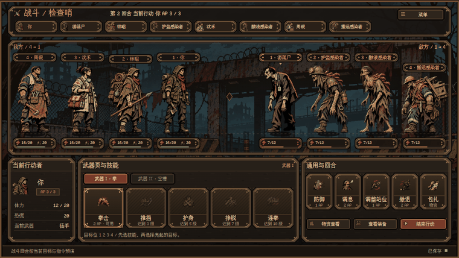

# 适者生存 · 重墨 V2 离线评审

这套评审稿来自「重墨 V2 粗框与动效修订」，保留重墨 V2 原有角色立绘。这里的战斗特写用于审阅构图、立绘位移、出手与受击时机；示例中的数值、状态和时长用于说明画面。后续如果深化角色动作，以这套立绘的轮廓、服装和配色为基础，再拆分躯干、四肢、武器和表情。该分支仅供离线评审。

## 怎么看

从 GitHub 切换到 `planning/ink-v2-offline-review` 分支，选择 **Code → Download ZIP**。解压后进入 `doc/策划案/重墨V2离线评审 v1.0/`。本地已有仓库时，也可以单独检出该分支。离线样机需要同目录的 `资料` 和 `素材`，打开时保留目录结构。

| 先看什么 | 打开方式 |
| --- | --- |
| 动效 | 用 Chrome 或 Edge 打开 [打开动效样机.html](打开动效样机.html)。下拉切换 23 个样例，可播放、暂停、拖动时间轴、直接看结果或减少动态效果。 |
| 全界面 | 用 Chrome 或 Edge 打开 [打开全界面.html](打开全界面.html)。可搜索 67 个页面并逐层开关，支持「仅美术」「仅 UI」「清晰阅读」。 |
| 分层源稿 | 选中页面后下载对应的 OpenRaster，使用 Krita 或 GIMP 查看 7 层。也可直接打开同编号 SVG，文字与图层保留结构。 |
| 时序与页面映射 | [开发动效说明](给开发的动效说明.md)说明动效时序和状态，[使用说明](使用说明.md)列出图层、页面索引与重建方法。 |

## 审阅顺序

- **P05a 战斗**　先看立绘大小、敌我间距、头顶信息和脚下数值，再在动效样机对照近战、远程、格挡和包扎。 [战斗效果图](效果图/P05a.png)
- **P09a 营地对白**　按发言者看左右交错气泡、出现顺序和文字层。 [对白效果图](效果图/P09a.png)
- **PXn 行动推进**　看中央浮窗的进度、结果和退出。对照动效样机中的搜集和中断样例。 [推进效果图](效果图/PXn.png)
- **P07b、P07c、P07d 势力鸟瞰**　看建筑默认描边、悬停或键盘聚焦、选中反馈。普通区域地图和地牢使用各自的路线节点。 [营区效果图](效果图/P07b.png)

记录评审意见时，请带上页面编号或动效名称、时间轴毫秒和图层名。当前样机与界面稿一起归档，后续动作细化仍可保留原立绘风格。游戏的实际操作、数值与状态以现行策划案和程序为准。
